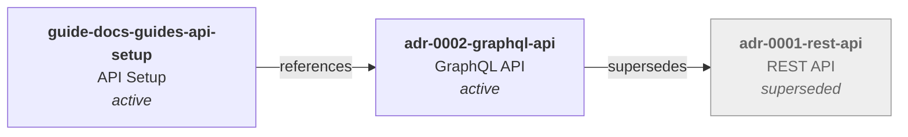
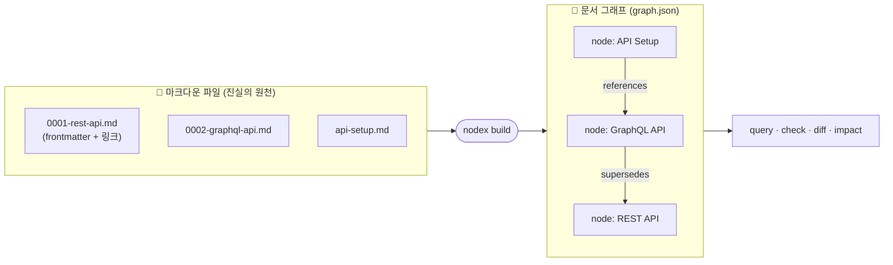
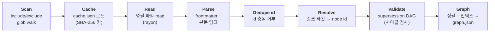

[](https://www.rust-lang.org)
[](LICENSE)

# nodex

> **[English](README.md)** | **한국어**

**마크다운 파일을 조회·검증·diff 가능한 문서 그래프로.**

nodex는 프로젝트의 마크다운 파일을 스캔해 YAML frontmatter와 링크 관계를 추출하고 불변 문서 그래프를 빌드합니다. 이 그래프는 JSON-first CLI로 조회, 검증, diff, 보고서 생성에 쓸 수 있으며, 안정적인 JSON 계약을 가진 Rust 바이너리 하나로 동작합니다.

---

## 목차

1. [문제 정의](#문제-정의)
2. [빠른 시작](#빠른-시작)
3. [워크스루: 파일에서 답까지](#워크스루-파일에서-답까지) — 파일 세 개로 빌드·조회·검사하고 편집을 게이트하는 과정
4. [핵심 개념](#핵심-개념) — 파일에서 그래프로, edge 종류, frontmatter 스키마
5. [동작 원리](#동작-원리) — build 파이프라인, 검증된 스냅샷
6. [명령](#명령) — 각 명령이 답하는 질문
7. [JSON-First CLI](#json-first-cli) — envelope, 종료·오류·경고 코드, 전역 플래그, 매니페스트
8. [검증](#검증) — 빌트인 룰, 편집과 커밋 게이트, 잠금과 status flow, 생명주기
9. [설정](#설정) — `nodex.toml` 예시와 섹션별 역할
10. [아키텍처](#아키텍처) — 워크스페이스와 설계 원칙
11. [설치](#설치)
12. [업그레이드](#업그레이드)
13. [라이선스](#라이선스)

명령별·키별 세부 의미는 Claude Code 스킬과 함께 배포되는 참고 문서(영문)에 있습니다: [명령](.claude/skills/nodex/reference/commands.md), [설정](.claude/skills/nodex/reference/config.md).

---

## 문제 정의

프로젝트 문서는 평평한 파일 더미가 아니라 그래프입니다. ADR-0002가 ADR-0001을 대체하고, 런북이 가이드에 의존하고, 스펙이 세 개의 룰로 구현됩니다. 하지만 이 그래프는 `[text](paths.md)`와 frontmatter 필드 안에 암묵적으로 존재해 `grep`과 `find`로는 보이지 않습니다. 그래서 일상적인 질문에 답하기 어렵습니다:

| 질문 | `grep`의 한계 | 실제로 필요한 것 |
|---|---|---|
| "이 ADR을 무엇이 대체했나?" | 텍스트가 아님 — supersession 추적 불가 | 어느 멤버에서든 전체 supersession 계보; 현재 문서는 live(terminal이 아닌) tip (fork면 여럿일 수 있음) |
| "이 문서에 무엇이 의존하나?" | 이름 매칭만, `related:` frontmatter 누락 | 모든 incoming edge |
| "대체된 결정을 아직 인용하는 문서는?" | 링크는 찾지만 대상이 대체됐는지는 모름 | 계보가 이어지는 terminal 문서를 인용하는 live 인용과, 각 인용이 대신 가리킬 문서 |
| "어떤 문서가 고립됐나?" | 부재는 검색 불가 | 들어오는 edge도, 자신을 `superseded_by`로 지목하는 선행 문서도 없는 live 문서 |
| "어떤 문서가 stale인가?" | 날짜 비교 불가 | 마지막 리뷰 후 임계를 넘긴 live(terminal이 아닌) 문서 |
| "이 ref 간 무엇이 바뀌었나?" | 라인 diff 수준 | 추가/제거 노드, status 전이, field 변경 |
| "auth 문서 찾기" | 'auth' 포함 전체 | id / title / tag 가중치 순위, 결과마다 필드별 점수 내역 |

nodex는 그 암묵적 그래프를 명시적으로 드러냅니다. 마크다운을 한 번 파싱해 인접 인덱스를 갖춘 타입이 있는 그래프를 만들고, 그 스냅샷에서 다시 파싱하지 않고 구조적 질문에 답합니다. pre-commit 검증, PR diff 게이트, 작성 전 비교 후보 조회, 외부 도구와의 vocabulary 동기화 같은 일상 작업은 JSON을 출력하는 명령 하나로 끝납니다.

**핵심 속성:**

- **그래프, 폴더가 아님** — supersession chain, backlink, cross-reference가 일급 시민
- **Config, 코드 아님** — 모든 프로젝트별 룰은 `nodex.toml`; 도메인 로직 하드코딩 0
- **증분 + 병렬** — Rust + rayon 병렬 read, SHA-256 파일별 캐시로 변경된 파일만 재파싱
- **JSON-first 계약** — help와 version 출력을 뺀 모든 명령이 안정된 envelope(`{ok, data, warnings}` / `{ok, error: {code, message}}`)와 분류된 오류 코드를 출력
- **순수 CLI** — 데몬·서버·AI/네트워크 의존성 없음, 모든 것이 동기 로컬 프로세스

---

## 빠른 시작

```bash
# 설치 (macOS / Linux)
curl -fsSL https://raw.githubusercontent.com/junyeong-ai/nodex/main/scripts/install.sh | bash

# 프로젝트에 config 초기화
nodex init

# 그래프 빌드
nodex build

# 문서 검색
nodex query search "auth"

# 관계 탐색
nodex query backlinks <node-id>
nodex query chain <node-id>

# 스키마 검증
nodex check

# 두 git ref 간 diff
nodex diff origin/main HEAD
```

모든 명령은 JSON을 출력합니다(`--help` / `help` / `--version` 제외). `--pretty`를 붙이면 들여쓴 JSON을 출력합니다.

---

## 워크스루: 파일에서 답까지

마크다운 파일 세 개가 있다고 합시다. 아키텍처 결정 두 개(하나는 다른 하나로 대체됨)와, 현재 결정을 링크하는 가이드 하나입니다:

```text
docs/
├── decisions/
│   ├── 0001-rest-api.md      # 옛 결정, 지금은 대체됨(superseded)
│   └── 0002-graphql-api.md   # 그것을 대체한 결정
└── guides/
    └── api-setup.md          # 현재 결정을 링크
```

옛 결정인 `docs/decisions/0001-rest-api.md`:

```markdown
---
title: REST API
status: superseded
superseded_by: adr-0002-graphql-api
created: 2025-01-10
---
# REST API
원래 API 설계.
```

현재 결정인 `docs/decisions/0002-graphql-api.md`:

```markdown
---
title: GraphQL API
status: active
created: 2025-01-20
---
# GraphQL API
현재 API 설계.
```

…그리고 가이드는 제목 아래에서 현재 결정으로 링크합니다:

```markdown
---
title: API Setup
status: active
created: 2025-02-01
---
# API Setup
[GraphQL API decision](../decisions/0002-graphql-api.md)에서 시작하세요.
```

최소 `nodex.toml`로 "어떻게 읽을지"를 알려줍니다(모든 키의 설명은 [설정 참고 문서](.claude/skills/nodex/reference/config.md)와 `nodex init`이 쓰는 템플릿에 있습니다):

```toml
[scope]
include = ["docs/**/*.md"]         # docs 트리만 스캔; 다른 곳의 임시 draft는 scope 밖

[kinds]
allowed = ["generic", "adr", "guide"]

[statuses]
allowed = ["active", "superseded"]
terminal = ["superseded"]

[[identity.kind_rules]]            # docs/decisions/ 아래 파일은 ADR
glob = "docs/decisions/**"
kind = "adr"
[[identity.kind_rules]]            # docs/guides/ 아래 파일은 guide
glob = "docs/guides/**"
kind = "guide"
[[identity.id_rules]]              # ADR의 id는 "adr-<파일명>"
kind = "adr"
template = "adr-{stem}"

[schema]
required = ["created"]             # 모든 문서는 created 날짜 필수
cross_field = [{ when = "status=superseded", require = "superseded_by" }]
```

**1. 그래프 빌드** — 파일을 한 번 스캔해 불변 그래프로:

```jsonc
$ nodex build --pretty
{ "ok": true, "data": {
  "nodes": 3, "edges": 2, "annotations": 0, "body_line_matches": 0,
  "cached": 0, "parsed": 3, "duration_ms": 1
} }
```

대체(supersession)와 본문 링크가 일급 edge인 그래프가 됩니다:



**2. "REST API 결정을 무엇이 대체했나?"** — `grep`은 못 답하지만 그래프 walk는 답합니다:

```jsonc
$ nodex query chain adr-0001-rest-api --pretty
{ "ok": true, "data": { "items": [
  { "id": "adr-0001-rest-api",    "title": "REST API",     "status": "superseded", ... },
  { "id": "adr-0002-graphql-api", "title": "GraphQL API",  "status": "active",     ... }
], "total": 2 }, "snapshot": {
  "verification": "content", "unbuildable": 0, "unfollowed": 0
} }
//  오래된 → 최신 — 이 선형 계보에선 현재 문서가 마지막 항목(유일한 `active` tip): GraphQL이 REST를 대체.
//  어느 멤버에서 시작하든(현재 문서에서도) 전체 계보를 얻음. (supersedes는 DAG — fork나 통합은 tip이 여럿일 수
//  있고, 현재성은 위치가 아니라 `status`로 판단.)
```

**3. "현재 결정을 무엇이 가리키나?"** — 출처와 무관하게 모든 incoming edge:

```jsonc
$ nodex query backlinks adr-0002-graphql-api --pretty
{ "ok": true, "data": { "items": [
  { "id": "guide-docs-guides-api-setup", "relation": "references", "location": "L7", ... }
], "total": 1 }, "snapshot": {
  "verification": "content", "unbuildable": 0, "unfollowed": 0
} }   //  가이드가 7번째 줄에서 링크
```

**4. 전체 코퍼스 검증** — schema·cross-field·탐지 룰을 한 패스로:

```jsonc
$ nodex check --pretty
{ "ok": true, "data": {
  "violations": [ {
    "rule_id": "orphan", "severity": "warning",
    "node_id": "guide-docs-guides-api-setup", "path": "docs/guides/api-setup.md",
    "message": "no document references this one; link it, set `orphan_ok: true`, or add its kind to [detection].orphan_ok_kinds",
    "details": { "type": "orphan" }
  } ],
  "skipped_rules": [],
  "rule_coverage": [
    { "rule_id": "acyclic_relation", "unit": "edges", "subjects": 0, "unjudged": 0 },
    ...
    { "rule_id": "required_field",   "unit": "nodes", "subjects": 3, "unjudged": 0 },
    ...
  ],
  "total": 1, "has_errors": false
} }
//  exit 0 — 모든 문서에 created가 있고 superseded ADR은 후속 문서를 명시합니다. finding 하나는 경고로,
//  guide를 가리키는 문서가 없다는 뜻입니다. violations는 무엇이 실패했는지만 말하고 얼마나 검사했는지는
//  말하지 않으므로, rule_coverage가 각 룰이 실제로 검사한 모집단(subjects)을 함께 싣습니다 —
//  acyclic_relation은 `implements` edge를 검사하며, 이 문서들에는 아직 그런 edge가 없습니다.
```

Supersession 사이클은 `build`가 거부합니다(`CYCLE_DETECTED`). 깨진 링크는 기본적으로 warning finding이며, 검사와 쓰기를 막을지는 설정한 severity가 정합니다.

**5. 쓰기 *전에* 편집을 게이트** — 에이전트가 새 ADR을 제안하면서 `created`를 빠뜨렸습니다. `check --content`는 디스크를 건드리지 않고 제안 바이트를 검증해 기계가 읽을 수 있는 형태로 답합니다:

```jsonc
$ nodex check --content docs/decisions/0003-grpc-api.md=draft.md --pretty
{ "ok": true, "data": {
  "violations": [
    { "rule_id": "orphan", "severity": "warning", "node_id": "adr-0003-grpc-api", ... },
    {
      "rule_id": "required_field", "severity": "error",
      "node_id": "adr-0003-grpc-api", "path": "docs/decisions/0003-grpc-api.md",
      "message": "missing required field: created",
      "details": { "type": "required_field", "field": "created" }   // ← 산문이 아니라 타입화
    }
  ],
  "skipped_rules": [],
  "rule_coverage": [ ..., { "rule_id": "required_field", "unit": "nodes", "subjects": 4, "unjudged": 0 }, ... ],
  "total": 2,
  "has_errors": true,
  "proposals": [ { "path": "docs/decisions/0003-grpc-api.md", "in_scope": true, "has_path_errors": true } ],
  "standing": [ { "rule_id": "orphan", "severity": "warning", "node_id": "adr-0003-grpc-api", ... } ]
} }
//  exit 1 — error가 게이트를 막습니다. violations는 제안이 새로 만든 위반으로, 새 ADR의 orphan 경고도
//  포함합니다. standing은 제안된 문서가 제안된 상태로 지닌 경고 전부입니다
```

에이전트는 `details.field == "created"`를 읽고 날짜를 추가하며, **메시지 문자열은 파싱하지 않습니다**. 모든 룰이 `type`으로 구분되는 이런 타입화 `details`를 싣고(`field_enum`은 `allowed` 집합, `field_type`은 기대 타입 등), 도구가 기계적으로 자동수정안을 낼 수 있습니다.

---

## 핵심 개념

### 파일에서 그래프로

nodex는 평평한 마크다운 파일 모음을 탐색할 수 있는 그래프로 바꿉니다. 각 문서는 **노드**가 되고, 문서 사이의 각 링크는 방향이 있는 **edge**가 됩니다. 그래서 파일 *사이*에 있는 질문(무엇이 이 문서를 대체했나? 무엇이 이 문서에 의존하나? 무엇이 고립됐나?)을 수동 교차 참조 대신 쿼리 하나로 풀 수 있습니다.



### Edge 종류

Edge는 YAML frontmatter 필드와 마크다운 본문, 두 곳에서 나옵니다.

| 출처 | 기본 relation | 예 |
|---|---|---|
| Frontmatter `supersedes` | `supersedes` | ADR 2가 ADR 1을 supersede |
| Frontmatter `superseded_by` | 후속 문서에서 나가는 `supersedes` | ADR 1이 ADR 2를 후속 문서로 지목 |
| Frontmatter `implements` | `implements` | 룰이 ADR을 구현 |
| Frontmatter `related` | `related` | 가이드가 ADR과 관련 |
| Frontmatter `covers` | `covers` | 문서가 `src/auth.rs`를 커버 (그래프 밖 코드 경로) |
| 본문 링크 `[text](path.md)` | `references` | 본문에서 다른 문서 참조 |
| 본문 위키링크 `[[id]]` (`[parser].wikilink_enabled`일 때) | `references` | 노드 id로의 위키링크 |
| 선언한 frontmatter 관계 (`[[parser.frontmatter_relations]]`) | **선언한 relation** | `sources: [doc-a]` → `derived_from` |
| 커스텀 패턴 (`[[parser.link_patterns]]`) | **새 relation 이름** | 예: `@path.md` → `imports` |

내장 관계의 생명주기와 대상 해석 방식은 그대로 유지되며, 프로젝트는 위의 두 선언으로 자기 관계를 추가합니다([frontmatter 관계](.claude/skills/nodex/reference/config.md#frontmatter-relations), [본문 링크](.claude/skills/nodex/reference/config.md#body-links)). 본문 링크는 정규식이 아니라 [pulldown-cmark](https://github.com/pulldown-cmark/pulldown-cmark) AST로 추출하므로 코드 블록 안의 링크는 코드로 남습니다. 커스텀 패턴도 같은 방식으로 코드를 건너뛰고, `rename` / `retarget`은 추출이 읽는 참조만 골라 다시 씁니다. 마크다운 목적지는 참조하는 문서의 디렉터리를 기준으로 해석하고, 위키링크와 커스텀 패턴은 프로젝트 루트 경로, 문서 상대 경로, 노드 id 순서로 대상을 찾습니다. 어디로도 해석되지 않는 대상은 원인과 함께 미해결 edge로 그래프에 남으며, `check`와 `query issues`가 이를 보고합니다.

### Frontmatter 스키마

| 필드 | 타입 | 필수 | 의미 |
|---|---|---|---|
| `id` | string | yes (path로 추론 가능) | 노드 식별자 |
| `title` | string | yes (추론 가능) | 사람이 읽는 이름 (첫 H1, 없으면 파일명 stem으로 폴백) |
| `kind` | string | yes (추론 가능) | 문서 타입 — `[kinds].allowed`에 있어야 함 |
| `status` | string | yes (추론 가능) | 생명주기 상태 — `[statuses].allowed`에 있어야 함; status 없는 문서는 그 kind에 flow가 적용되면 `statuses.flow[].initial`, 아니면 `[statuses].initial`(없으면 첫 allowed 값)을 받음 |
| `created` / `updated` / `reviewed` | date (ISO) | optional | 각각 작성 / 수정 / 마지막 리뷰 — `reviewed`는 `stale_review`, `git_drift`가 기준으로 삼는 날짜 |
| `owner` | string | optional | 소유자 식별자 |
| `supersedes` | string \| array | optional | 대체된 문서 ID |
| `superseded_by` | string | optional | 대체 문서 ID (스칼라) |
| `implements` | string \| array | optional | 구현 대상 스펙 ID |
| `related` | string \| array | optional | 관련 문서 ID |
| `tags` | string \| array | optional | 임의 태그 |
| `covers` | string \| array | optional | 이 문서가 권위를 주장하는 소스 코드 경로 — 파일 또는 디렉터리 전체 |
| `orphan_ok` | bool | optional (기본 false) | orphan 경고 억제 |
| (그 외) | any | optional | `attrs`에 저장, `[schema].mode = "strict"`일 때는 거부 |

배열 필드는 단일 문자열과 배열 두 형태 모두 받습니다.

---

## 동작 원리

### Build 파이프라인

`nodex build`는 고정된 결정론적 파이프라인을 실행해 파일을 읽고 불변 그래프를 만듭니다:



| 단계 | 내용 |
|---|---|
| **Scan** | `[scope]`의 include / exclude glob을 탐색. `conditional_exclude` 룰은 terminal 부모의 sub-artifact를 빼고, build가 뺀 경로를 알림 |
| **Cache** | SHA-256이 바뀌지 않은 파일은 `_index/cache.json`을 재사용 |
| **Read** | 파일을 병렬로 읽음. 읽을 수 없거나 UTF-8이 아닌 파일은 조용히 버리지 않고 error severity `parse_failure`로 기록 |
| **Parse** | frontmatter 파싱, 마크다운 링크 추출, 설정된 패턴 실행을 병렬로 수행 |
| **Dedupe IDs** | 두 문서가 같은 id로 해석되면 build를 거부 (`DUPLICATE_ID`) |
| **Resolve** | 각 링크 대상을 [Edge 종류](#edge-종류)에서 설명한 조회 규칙으로 node id에 연결. 일치하는 대상이 없으면 원인을 담은 미해결 edge가 됨 |
| **Validate** | `supersedes` cycle을 거부 (`CYCLE_DETECTED`) |
| **Graph** | 노드와 edge를 정렬하고 양방향 인접 인덱스를 만든 뒤 `_index/graph.json`을 씀 |

`build`는 그래프에 넣지 않은 것을 목록으로 알리고, 빈 목록은 생략합니다. 파싱에 실패한 문서, conditional exclude로 뺀 경로, 문서가 없는 항목, 따라가지 않은 심볼릭 링크가 여기에 해당합니다([build](.claude/skills/nodex/reference/commands.md#build)).

### 검증된 스냅샷

조회는 마크다운을 다시 파싱하지 않고 `_index/graph.json`에서 답합니다. 답하기 전에 스냅샷이 설정, scope의 멤버십, 각 문서의 내용과 여전히 일치하는지 확인하고, 어긋나면 `GRAPH_OUTDATED`로 거부합니다. `--allow-stale`은 내용 비교를 건너뜁니다(`snapshot.verification: "membership"`). 설정이나 멤버십이 어긋나면 거부하지 않고 `snapshot_divergence` 경고를 붙입니다. 목록 조회나 `--with-body` 없는 `query node`처럼 스냅샷에 기록된 값만 읽는 조회는 문서 내용이 바뀐 것을 알아차리지 못합니다. 본문을 읽는 조회(`query node --with-body`, `query nodes --body-contains`)와 찾지 못한 id 조회는 여전히 내용을 비교해 `GRAPH_OUTDATED`로 거부합니다. 조회는 스냅샷을 다시 만들지 않습니다. `nodex build`는 내용이 바뀐 파일만 다시 파싱하고, `nodex build --full`은 캐시를 무시합니다. 스냅샷 스키마가 호환되지 않으면 두 모드 모두 기록된 버전과 지원 버전을 담은 `GRAPH_OUTDATED`를 냅니다. 스냅샷을 읽는 것은 조회와 `nodex status`뿐이며, `check`는 working tree에서 직접 빌드하므로 먼저 build할 필요가 없습니다. 조회 envelope의 `snapshot`에는 이번 읽기가 무엇을 검증했는지와, 스냅샷이 파싱하지 못한 문서 수가 담깁니다([조회](.claude/skills/nodex/reference/commands.md#query), [`nodex status`](.claude/skills/nodex/reference/commands.md#status)).

---

## 명령

| 명령 | 답하는 질문 |
|---|---|
| `nodex init` | 주석 달린 `nodex.toml` 생성. 실행 중인 바이너리의 minor 버전을 적은 `[meta] nodex_version` 핀은 주석 처리된 채로 들어감 |
| `nodex build [--full]` | 그래프 스냅샷 빌드. `--full`은 캐시 무시 |
| `nodex status` | 스냅샷이 working tree와 일치하는지, 어디서 어긋나는지 |
| `nodex check` | 프로젝트에 등록된 모든 룰. `--content`는 제안된 바이트, `--staged`는 다음 커밋, `--since <ref>`는 이력 구간을 판정 |
| `nodex report` | 그래프를 읽기 좋게 요약한 `GRAPH.md` 생성 |
| `nodex diff <a> <b>` | 두 git ref 사이에서 바뀐 노드·edge·status·필드·경로·annotation |
| `nodex impact <a> <b>` | diff에 더해, 바뀐 문서마다 그 문서에 의존하는 문서와 이제 끊어지는 참조 |
| `nodex query search <kw>` | id·title·tag 일치 결과와 필드별 점수 기여 |
| `nodex query nodes` | kind·status·tag·필드 값·필드 누락·본문 텍스트 필터에 맞는 문서를 요청한 필드로 projection |
| `nodex query node <id>` | 문서 하나와 그 edge, 요청하면 본문까지. `--path`는 파일 경로로 조회 |
| `nodex query backlinks <id>` | 그 문서로 들어오는 모든 edge (인용하는 문서와 관계마다 한 항목) |
| `nodex query chain <id>` | 어느 멤버에서 시작하든 전체 supersession 계보 (오래된 순) |
| `nodex query dependents <id>` | 그 문서를 직접, 또는 `--depth` 홉 안에서 참조하는 문서 |
| `nodex query neighborhood <id>` | 방향과 무관하게 N홉 안에 있는 모든 문서 |
| `nodex query components` | 연결 컴포넌트 (큰 순서) |
| `nodex query orphans` | 설정된 예외를 빼고, 다른 문서의 참조를 하나도 받지 않는 live 문서 |
| `nodex query stale` | 마지막 리뷰 후 `[detection].stale_days`일 이상 지난 live 문서 |
| `nodex query recent` | 날짜 필드가 구간 안에 드는 문서 |
| `nodex query similar` | 문서나 초안 제목의 비교 후보 (제목·태그·이웃 겹침 기준) |
| `nodex query covered-by <path>` | `covers:`에 그 코드 경로나 그 경로를 담은 디렉터리를 적은 문서 |
| `nodex query annotations` | 선언된 블록과 키로 묶은 본문 마커 |
| `nodex query issues` | orphan, stale 문서, 미해결 참조, 룰 위반을 모은 보고서 |
| `nodex scaffold` | 유효한 frontmatter를 갖춘 새 문서를 쓰기 게이트를 거쳐 생성 |
| `nodex rename <old> <new>` | 문서를 옮기고 그 문서를 가리키는 참조를 다시 씀 |
| `nodex retarget <old> <new>` | 한 id를 가리키던 참조를 다른 id로 재지정. `--supersede`는 이전 문서의 supersede까지 처리 |
| `nodex lifecycle supersede <id>` | 문서를 `--to <new-id>`로 supersede 처리 |
| `nodex lifecycle set <id>` | `--status`를 문서의 kind가 허용하는 status로 설정 |
| `nodex lifecycle review <id>` | 오늘을 리뷰 날짜로 기록 |
| `nodex migrate` | frontmatter 없는 마크다운에 넣을 frontmatter를 계획. `--apply`가 실제로 씀 |
| `nodex export …` | [매니페스트](#매니페스트)에 나열한 출력 |

`scaffold`, `rename`, `retarget`은 `--dry-run`을 받습니다. 이 모드는 모든 게이트를 실행하지만 아무것도 쓰지 않습니다. 플래그, 결과 형태, 예외 상황은 [명령 참고 문서](.claude/skills/nodex/reference/commands.md)(영문)에 있고, `nodex export commands`가 모든 명령과 플래그를 나열합니다.

---

## JSON-First CLI

모든 명령은 stdout에 JSON을 출력하며, 사람이 읽는 텍스트를 내는 것은 clap의 help 출력(`--help`, `help` 명령, `--version`)뿐입니다.

### Envelope

**Success:**
```json
{
  "ok": true,
  "data": { /* 명령별 형태 */ },
  "warnings": [{ "code": "...", "message": "...", "details": { /* 선택적 typed 근거 */ } }],
  "snapshot": { /* 스냅샷 조회만: 읽기가 검증한 것 */ }
}
```
- 비어있으면 `warnings` 생략
- 목록 조회는 `data: { items: [...], total: N }`을 반환하며 두 필드가 항상 있습니다. 일반 목록(`nodes`, `search`, `backlinks`, `orphans`, `stale`, `components`)의 `total`은 일치한 전체 개수이고, `--limit`으로 잘린 응답에는 `returned`가 붙습니다(잘리지 않으면 생략). 따라서 잘린 응답이 전체 결과처럼 읽히지 않습니다. `similar`와 `recent`는 core에서 후보를 골라 내므로 `total`은 고른 개수입니다. `query node`, `query issues`, `query neighborhood`, `query dependents` 네 조회는 목록 대신 객체 형태의 보고서를 반환합니다.

**Error:**
```json
{ "ok": false, "error": { "code": "ERROR_CODE", "message": "..." } }
```

### 종료 코드

| 코드 | 의미 |
|---|---|
| `0` | 명령 오류나 실제 배치 쓰기 실패 없이 완료. 정책에 따른 보류와 범위 경고는 남을 수 있음 |
| `1` | `nodex check`가 `severity = error` 위반 발견 |
| `2` | error envelope, 결과 envelope을 그대로 내는 실제 배치 쓰기 실패, 또는 stdout 출력 실패 (먼저 닫힌 파이프, 가득 찬 디스크) |

### 오류 코드

Error code는 typed `nodex_core::error::Error`의 `downcast_ref`로 도출하며, 메시지 문자열로 매칭하지 않습니다.

<!-- published:error-codes -->

| 코드 | 원인 |
|---|---|
| `CYCLE_DETECTED` | `supersedes` cycle |
| `DUPLICATE_ID` | 동일 node id가 두 문서에 |
| `PARSE_ERROR` | 쓰기 명령이 frontmatter가 파싱되지 않는 문서(`lifecycle`은 frontmatter가 없는 문서도: `nodex migrate --apply`가 만들어 줌)를 만났거나, `graph.json`이 손상됨(`nodex build --full`) — build는 깨진 문서를 `parse_failure` 위반으로 기록 |
| `INVALID_TRANSITION` | `lifecycle` 액션이 허용 안 되는 status에서 시도됨 |
| `NOT_FOUND` | 참조한 node id가 그래프에 없음 |
| `GRAPH_MISSING` | `graph.json` 스냅샷 없이 `query` 실행 — `nodex build` 먼저 |
| `GRAPH_OUTDATED` | 조회가 스냅샷이 설정, scope 멤버십, (기본 모드에서는) 문서 내용과 어긋났음을 확인했거나, 요청한 본문이 색인된 리비전과 다르거나, 스냅샷 스키마가 호환되지 않음 — `nodex build`로 재생성(스키마 불일치는 `--full`) |
| `WRITE_CONFLICT` | 변경 명령이 문서를 읽은 뒤 그 문서가 바뀜. 현재 리비전을 다시 읽고 재시도 |
| `ALREADY_EXISTS` | `init` / `scaffold` / `rename` 대상 경로에 실제 파일이 이미 존재 |
| `PATH_ESCAPES_ROOT` | `..` / 심볼릭 링크가 프로젝트 루트를 벗어남 |
| `SYMLINK_TARGET` | 쓰려는 대상의 마지막 경로 구성요소가 심볼릭 링크여서 거부됨. nodex는 링크를 따라가며 쓰지 않음 |
| `CONTENT_VIOLATIONS` | 쓰기 게이트가 쓰기를 거부: 쓰려는 내용이 Error-severity `check` 위반을 새로 만듦 (각각 `rule_id: message`로 나열) |
| `CONFIG_ERROR` | `nodex.toml`이 로드 시점 검증에 실패, 인자가 config에 선언되지 않은 것을 지목(`--fields`, `--where`, `--name`, kind가 허용하지 않는 `lifecycle` status)하거나 명령이 처리할 수 없는 값을 지님(`=` 없는 `--content`, `--depth 0`, 디렉터리 `rename`, `retarget X X`), 잠금이 읽는 `rules.immutable_baseline`이 git이 해석하지 못하는 ref를 가리킴, 또는 쓰기 결과를 잠금이 거부함(메시지가 잠금과 해결 방법을 밝히며, `retarget --supersede`는 잠금이 선행 문서의 status 변경을 막을 때 거부) |
| `IO_ERROR` | filesystem read/write 실패 |
| `VERSION_MISMATCH` | 실행 바이너리가 버전 요구사항을 벗어남 — `--check-version <req>` 플래그(모든 명령) 또는 `[meta] nodex_version` pin 아래의 쓰기 명령 |
| `GIT_ERROR` | `git` 호출 실패 또는 거부 (work tree 없음, ref 부재, 충돌이 남은 index 등) — 주로 `diff` / `impact` / `check --since` / `check --staged`에서 발생 |
| `INVALID_ARGUMENT` | clap 파싱 실패 |
| `INTERNAL_ERROR` | 미분류 (버그) |

<!-- /published:error-codes -->

### 경고 코드

`warnings[]`는 결과의 범위·보존 조건 등을 설명합니다. 경고만으로 성공 여부를 판단하지 말고 종료 코드와 결과, 배치의 `failures`를 함께 확인합니다.

<!-- published:warning-codes -->

| 코드 | 의미 |
|---|---|
| `scope_coverage` | 읽은 것과 프로젝트가 관할하는 것이 어긋남 — 아무것도 고르지 않은 선언, 어느 `identity` 룰에도 걸리지 않는 문서, walk가 읽지 못한 트리 부분, scope가 받지 않는 `check --content` 경로 |
| `snapshot_divergence` | 스냅샷 변경 또는 최신성 검사 실패 — 변경 시 재빌드, 검사 실패 시 메시지에 표시된 원인 해결 |
| `build_recommended` | 변경 명령이 그래프를 일관되게 만들 후속 조치를 남김 (메시지가 지목) |
| `binary_compat` | 바이너리가 `[meta] nodex_version` 핀 밖 — 읽기는 실행, 쓰기는 거부 |
| `gate_suppression` | 나열된 위반이 판정한 집합과 다름(`--severity`, 또는 프로젝트를 담지 않은 `--since` ref); `has_errors`와 exit code는 판정한 위반 전체에 대해 답함 |
| `baseline_inert` | 기준으로 삼은 git ref에 조회한 대상이 없음 — 잠금 미적용, 한 문서에 대해 비활성, 또는 `diff` / `impact` 비교의 한쪽에 경로가 없음 |
| `ranking_unscored` | 점수가 없는 후보를 랭킹에서 빼고 그 수를 셈 |
| `file_skipped` | 편집이 뜻대로 되지 않음 — 무언가가 막았거나, 옮긴 참조가 이제 다른 문서를 가리키거나 아무것도 가리키지 않음 |
| `reference_kept` | 선언된 retarget 정책 또는 자기 참조 방지를 위해 참조를 보존함 |
| `document_evicted` | 쓰기가 `conditional_exclude` 부모를 terminal로 만들어 그 sub-artifact를 프로젝트에서 뺌 |
| `history_unread` | step 룰이 판정에 필요한 이력을 읽지 못함 — 빌드가 트리를 거부하는 커밋, 또는 shallow clone이 가져오지 않은 이력; 그 기록은 `unjudged`로 셈 |
| `threshold_undeclared` | `[detection].stale_days` 없이 `query stale`을 실행한 경우처럼, 프로젝트가 선언하지 않은 탐지 기준을 묻는 목록은 아무것도 측정하지 않음. 그래서 빈 답이 깨끗한 결과라는 뜻이 아님 |
| `cache` | 캐시를 읽거나 저장하지 못함; 다음 실행이 그 작업을 다시 함 |

<!-- /published:warning-codes -->

### 전역 플래그

| 플래그 | 효과 |
|---|---|
| `-C DIR` | `git -C`처럼 `DIR`에서 시작한 것처럼 동작 |
| `--pretty` | JSON pretty-print |
| `--jobs N` | 프로세스당 병렬 작업자 수 제한. 지정하지 않으면 Rayon이 `RAYON_NUM_THREADS` 또는 사용 가능한 CPU 수를 따름 |
| `--check-version <REQ>` | 바이너리 버전이 SemVer 요구사항을 만족하지 않으면 거부 (CI pin) |
| `--today <YYYY-MM-DD>` | 날짜 기준 룰·쿼리(stale, orphan grace, recent 구간)와 nodex가 쓰는 날짜를, DATE가 오늘인 것으로 보고 계산 — 재현 가능한 실행 |

### 매니페스트

```bash
nodex export schema                           # frontmatter JSON Schema (draft 2020-12)
nodex export enums                            # kinds + statuses + per-field enums
nodex export rules                            # active rules (built-in + config-driven) + `params`
nodex export envelope-schema [--inline-refs]  # 모든 CLI envelope 형태의 JSON Schema (타입 코드 생성 계약)
nodex export config                           # 해석된 scope / output / parser / scaffold / identity 설정과 fallback
nodex export commands                         # 모든 명령과 그 positional, 플래그
nodex export diagnostics                      # 오류·경고·종료 코드 vocabulary (닫힌 집합, 코드 생성용)
```

의존 방향은 한쪽으로 고정되어 있습니다. nodex가 내보내고 외부 도구(린터, IDE 플러그인, CI 동기화 게이트)가 소비하며, nodex는 자기 vocabulary를 얻으려고 외부 파일을 파싱하지 않습니다. `export envelope-schema`는 코드 생성 계약입니다. 명령별 스키마는 중첩 타입을 `$defs`에 묶고 그 이름이 생성될 모델의 이름이 되며, `--inline-refs`는 `$ref`를 따라가지 못하는 생성기를 위해 각 스키마를 자기 완결 형태로 내보냅니다. 릴리스마다 `nodex-envelope-schema-v<ver>.json`과 `nodex-commands-v<ver>.json`을 버전을 고정해 쓸 수 있는 자산으로 게시하며, 형태가 바뀌었는데 필요한 버전 상승이 없으면 릴리스 CI가 거부합니다.

---

## 검증

### 빌트인 룰

`nodex check`는 등록된 모든 룰을 실행하고 위반을 `violations`에 나열합니다. 각 위반에는 `rule_id`, `severity`, 대상 문서(`node_id` / `path`), `message`, 그리고 타입화된 `details`가 실립니다. `details`의 `type`은 실패의 종류를, 나머지 필드는 문제 필드나 허용 집합, 실패 값 같은 파라미터를 담으므로 도구는 메시지를 파싱하지 않고 `details`로 분기합니다. `skipped_rules`는 실행하지 못한 룰과 그 이유를 알리고, `rule_coverage`는 실행한 룰마다 검사 대상 모집단(`subjects`)과 판정하지 못한 기록(`unjudged`)을 알립니다. 두 목록을 합치면 레지스트리 전체가 됩니다. 비어 있는 `violations`는 철저한 통과와 공허한 통과에서 똑같이 보이며, 둘을 구분해 주는 것이 `subjects: 0`입니다([check 동작](.claude/skills/nodex/reference/commands.md#check)).

| `rule_id` | Severity | 검사 내용 |
|---|---|---|
| `parse_failure` | error | scope 안의 모든 문서가 파싱됨. 빠진 문서는 노드 없는 error이며, 게이트가 무시하는 warning이 아님 |
| `field_parse` | error | 파서가 소유한 frontmatter 필드가 제 타입으로 파싱됨. 실패한 값(잘못된 날짜, 잘못된 bool)은 없는 것으로 읽고, 남아 있는 노드에 표시 |
| `required_field` | error | 필수 필드(`[schema].required`와 kind별 override)가 있음 |
| `forbidden_field` | error | kind별 override가 `forbidden`에 둔 필드가 없음 |
| `field_type` | error | `attrs` 값이 선언된 `types`(string / integer / bool / date)와 일치 |
| `field_enum` | error | `attrs`, `kind`, `status`가 선언된 `enums` 허용 목록 안에 있음 |
| `cross_field` | error | `when status=superseded require superseded_by` 같은 조건부 요구 |
| `unknown_field` | error | 선언하지 않은 frontmatter 키 (`[schema].mode = "strict"`에서만) |
| `explicit_field` | error | `[schema].require_explicit`가 지정한 추론 가능 빌트인을 추론에 맡기지 않고 직접 작성 |
| `filename_pattern` | error | 파일명이 `[[rules.naming]].pattern`과 일치 |
| `sequential_numbering` | warning | naming 블록이 `sequential = true`일 때 파일 앞 번호에 빠진 번호가 없음 |
| `unique_numbering` | error | naming 블록이 `unique = true`일 때 두 파일이 같은 앞 번호를 쓰지 않음 |
| `stale_review` | warning | `reviewed` 날짜가 `[detection].stale_days`일 이상 지난 live 문서. 날짜가 없으면 `unjudged`로 셈 |
| `orphan` | warning | 들어오는 edge도, 자신을 `superseded_by`로 지목하는 선행 문서도 없는 live 문서 (설정된 예외 제외) |
| `superseded_reference` | warning | terminal 문서를 인용하는 live 문서 중, 그 terminal 문서의 계보가 live 문서로 이어지는 경우. 계보가 이어지는 문서는 `details.current`가 알려 줌 |
| `git_drift` | warning | 링크한 문서와 `covers` 경로에 `reviewed` 이후 쌓인 커밋 수의 합이 `git_drift_threshold`를 넘는 live 문서 (opt-in) |
| `frontmatter_immutable/<name>` | error | 블록의 `trigger`로 잠금이 걸린 뒤 블록이 잠근 필드가 바뀜 |
| `body_immutable/<name>` | error | 블록의 `trigger`로 잠금이 걸린 뒤 본문이 바뀜. `frozen`은 모든 편집을 거부하고, `append_only`는 잠긴 본문이 새 본문의 앞부분으로 남아야 함 |
| `status_transition` | error | `[[statuses.flow]]`가 선언하지 않은 status 이동. terminal status를 벗어나는 이동 포함 |
| `status_entry` | error | 진입 status가 아닌 status로 flow에 들어온 기록 |
| `body_line/<name>` | error | `[[rules.body_line]]` 패턴에 맞는 줄의 캡처 값이 선언된 enum 안에 있음 |
| `acyclic_relation` | error | `rules.acyclic_relations`의 각 relation(기본 `implements`)이 순환하지 않음. finding마다 끊을 edge를 하나 알려 줌 |
| `unresolved_reference` | warning | 어떤 문서와도 맞지 않는 참조. `[rules].severity`로 error 승격 가능 |
| `unresolved_reference/<name>` | 설정값 | info가 아닌 `[[detection.unresolved_policy]]` row마다 하나 |

설정에 따라 어떤 룰이 등록되는지와 각 룰의 모집단에서 무엇이 빠지는지는 [빌트인 룰 id](.claude/skills/nodex/reference/config.md#built-in-rule-ids)(영문)에 있습니다. `nodex export rules`는 등록된 룰을 각 룰의 파라미터와 함께 나열합니다.

### 편집과 커밋 게이트

```bash
nodex check --content docs/a.md=-                            # stdin으로 받은 제안 바이트
nodex check --content docs/a.md=- --content docs/b.md=b.md   # 여러 제안을 한 그래프로
nodex check --staged                                          # 다음 커밋이 기록할 프로젝트
```

`check --content <path>=<source>`는 내용을 쓰기 전에 검증합니다. `<source>`는 `-`(stdin)이거나 파일입니다. 모든 제안을 한 빌드에서 working tree 위에 겹치므로, supersede와 그에 따른 참조 문서 재작성 같은 배치를 하나의 변경으로 판정합니다. 게이트는 제안이 *새로 만든* 위반이 있으면 실패하며(exit 1), 그 위반이 그래프의 어느 문서에 생기든 마찬가지입니다. 문서에 이미 있던 error는 편집을 막지 않지만, 잠금은 예외입니다. 잠금은 제안된 문서를 설정된 기준선과 비교해(기준선을 설정하지 않았으면 working tree와 비교해) 절대적으로 판정하므로, 이미 잠금에서 벗어난 문서는 그 차이를 되돌리지 않는 한 어떤 제안도 통과하지 못합니다. status flow는 제안이 커밋될 때의 한 단계를 판정합니다. 캐시를 포함해 아무것도 쓰지 않습니다([자세히](.claude/skills/nodex/reference/commands.md#check)).

`check --staged`는 working tree가 아니라 다음 커밋이 기록할 내용을 판정합니다. index의 사본을 tree로 쓰므로 index 자체는 잠그지도 쓰지도 않으며, 만든 tree는 그 안에 담긴 `nodex.toml`로 검사합니다. `git commit -a`와 `git commit <path>`에서는 git이 `GIT_INDEX_FILE`로 알려 주는 index를 읽습니다([자세히](.claude/skills/nodex/reference/commands.md#check---staged)).

```sh
#!/bin/sh
# .git/hooks/pre-commit
exec nodex check --staged
```

쓰기 명령도 쓰기 전에 같은 판정을 거칩니다. `rename`, `retarget`, `lifecycle`은 error severity 위반을 새로 만드는 쓰기를 거부하고(`CONTENT_VIOLATIONS`), `--body`나 `--field`를 받은 `scaffold`도 마찬가지입니다. 이 둘이 없으면 `scaffold`는 문서를 쓰고, 새 문서 자신의 error severity 위반은 채울 항목으로 경고에 담으며, 다른 문서에 생기는 위반만 거부합니다. 잠금은 대신 `CONFIG_ERROR`로 거부합니다. 메시지는 잠금과 그 잠금이 고정한 부분을 밝히고, 어느 해결 방법이 맞는지 알려 줍니다. `nodex check`가 보고하는 drift라면 되돌리고, 잠금이 금지하는 변경이라면 그 변경을 하지 않습니다. `lifecycle`, `rename`, `scaffold`는 잠금이 거부할 상태로 문서를 남기는 쓰기를 거부하고, 쓰기 전부터 잠금에서 벗어나 있던 문서도 마찬가지입니다. `retarget`은 잠긴 부분만 남겨 두고 경고하지만(`file_skipped`), `--supersede`에서는 선행 문서의 status 변경이 필수이므로 잠금이 그 변경을 막으면 아무것도 쓰기 전에 같은 설명과 함께 명령 전체를 거부합니다.

### 잠금과 Status flow

두 룰 패밀리는 변경을 그 이전 상태에 비추어 판정합니다.

**잠금**은 기록이 확정한 내용을 지킵니다. `[[rules.frontmatter_immutable]]`은 필드를, `[[rules.body_immutable]]`은 본문을 잠급니다. 본문 잠금의 모드는 `frozen` 또는 `append_only`이며, `append_only`에는 본문 마지막 헤딩 하나 아래에서만 교정을 받는 `append_section`을 둘 수 있습니다. 블록의 `trigger`는 잠금이 걸리는 시점을 정합니다. `terminal`(기본)은 terminal status에서, `status`는 블록이 지정한 status에서, `creation`은 첫 커밋부터 잠금을 겁니다. 비교 기준은 `rules.immutable_baseline`이며(`nodex init`은 `HEAD`를 씀), `check`, `query issues`, `check --content`, 모든 쓰기가 같은 기준선을 읽습니다.

```toml
[rules]
immutable_baseline = "origin/main"
immutable_baseline_mode = "merge_base" # 기본 "ref": 지정한 커밋 자체
immutable_history = "snapshot"         # 기본 "steps": 각 커밋 단계도 검사

[[rules.body_immutable]]
name = "adr-decisions"
mode = "frozen"
trigger = "creation"
kinds = ["adr"]
```

**Status flow**는 생명주기가 있는 kind에 그 생명주기를 선언합니다.

```toml
[[statuses.flow]]
kinds = ["adr"]          # 비우면 모든 kind
initial = "proposed"     # flow가 적용되는 kind가 시작하는 status; 생략하면 [statuses].initial
transitions = { proposed = ["active"], active = ["superseded", "archived"] }
```

flow를 선언하면 `status_transition`과 `status_entry`가 등록되고, `lifecycle`, `retarget --supersede`, `scaffold --force`는 flow가 선언하지 않은 이동을 거부합니다. 두 룰은 git 이력을 한 단계씩 판정합니다. 모든 검사는 커밋되지 않은 변경을 `HEAD`와 비교해 판정하고, `check --since <ref>`는 여기에 더해 구간의 각 커밋을 그 부모와 비교해 판정합니다. 그래서 선언되지 않은 status를 거쳐 간 우회도 그 단계를 만든 커밋에서 보고됩니다. 빌드가 거부하는 커밋이나 shallow clone이 잘라 낸 이력처럼 읽을 수 없는 단계가 있으면, 그 기록은 `unjudged`로 세고 `history_unread` 경고가 무엇이 빠졌는지 알립니다. clone이 담지 못한 `--since` 구간은 거부되므로, 구간을 검사하는 CI 작업은 `fetch-depth: 0`으로 이력을 가져옵니다.

`check --since <ref>`는 보고를 diff가 영향을 준 finding으로 좁히지만, `rule_coverage`는 각 룰의 모집단 전체를 그대로 보고합니다. 기준선도, `--since`도, 비교할 제안 내용도 없으면 잠금은 통과로 처리되지 않고 `skipped_rules`에 나타납니다.

더 보기(영문): [잠금과 trigger](.claude/skills/nodex/reference/config.md#diff-aware-rules) · [status flow](.claude/skills/nodex/reference/config.md#status-flow) · [구간 검사](.claude/skills/nodex/reference/commands.md#check---since) · [nodex가 git을 읽는 방식](.claude/skills/nodex/reference/config.md#git-measurement)

### 생명주기

`nodex lifecycle <action> <id>`는 문서의 status를 바꿉니다(`retarget --supersede`도 같은 `supersede` 단계를 참조 재지정과 함께 실행합니다).

| 액션 | 결과 `status` | 기타 쓰는 필드 |
|---|---|---|
| `supersede --to <new-id>` | `superseded` | `superseded_by: <new-id>`, `updated: <today>` |
| `set --status <s>` | `<s>` | `updated: <today>` |
| `review` | (변경 없음) | `reviewed: <today>` (기존 `reviewed`가 미래 날짜면 거부 — 절대 뒤로 가지 않음) |

`supersede`는 후속 문서가 있는지와 supersession 그래프가 순환하지 않는지도 확인합니다. `set`은 문서의 kind가 허용하는 status를 모두 받습니다. 다만 프로젝트 자신의 `check`가 거부할 status와 status flow가 선언하지 않은 이동은 거부합니다(`superseded_by` 없이 `superseded`로 바꾸는 일은 `supersede`의 몫입니다). 문서를 terminal status에서 꺼내는 `lifecycle` 액션은 없습니다(`set`은 `INVALID_TRANSITION`으로 거부합니다). 다만 `[[statuses.flow]]`를 선언하지 않으면 직접 편집이나 `scaffold --force`로는 꺼낼 수 있고, 이를 보고하는 것은 선언된 flow의 `status_transition`뿐입니다. kind가 `updated`를 금지하면 `updated`를 쓰지 않습니다([자세히](.claude/skills/nodex/reference/commands.md#lifecycle)).

### 바이너리 버전 핀

`nodex.toml`의 `[meta] nodex_version = ">=0.61, <0.62"`은 프로젝트 문서를 **쓸** 수 있는 바이너리를 고정합니다. 요구를 벗어난 바이너리에서도 읽기 명령은 실행되며 envelope `warnings`에 치명적이지 않은 경고를 붙이고, 쓰기 명령(`scaffold`, `migrate --apply`, `rename`, `retarget`, `lifecycle`)만 `VERSION_MISMATCH`로 거부합니다. 이 명령들의 `--dry-run`은 아무것도 쓰지 않으므로 경고만 붙이고 읽기처럼 실행됩니다. 그래프를 읽는 일은 그래프를 손상시킬 수 없으므로 변경만 막습니다. 그래서 CI나 컨트리뷰터마다 검사를 다시 짜지 않고도 프로젝트가 도구 버전을 고정합니다. 전역 `--check-version` CLI 플래그는 불일치하면 *모든* 명령을 거부하는 별도의 하드 게이트입니다.

---

## 설정

모든 동작은 `nodex.toml`이 결정합니다. `nodex init`은 주석 달린 시작 설정을 씁니다. 실행 중인 바이너리의 minor 버전을 적은 `[meta] nodex_version` 핀은 주석 처리되어 있으므로, [바이너리 버전 핀](#바이너리-버전-핀)을 걸려면 이 주석을 해제합니다. 로드할 때 파일 전체를 검증하고, `allowed`에 없는 terminal status나 컴파일되지 않는 패턴, 선언하지 않은 kind를 지목한 룰처럼 일관되지 않은 설정은 `CONFIG_ERROR`로 거부합니다. 그래서 잘못된 설정은 어떤 명령도 실행되기 전에 실패합니다. 프로젝트가 실제로 해석한 값은 `nodex export config`와 `nodex export rules`로 확인하고, 키 설명은 [설정 참고 문서](.claude/skills/nodex/reference/config.md)(영문)에 있으며, `[similarity]`, `[search]`, `[report]`는 `nodex init`이 쓰는 템플릿에 설명되어 있습니다.

```toml
[scope]
include = ["docs/**/*.md", { glob = "specs/**/*.md", may_be_empty = true }, "README.md"]
exclude = ["docs/drafts/**"]
# terminal 부모의 sub-artifact를 빼고, 뺀 경로는 build가 알립니다:
# [[scope.conditional_exclude]]
# parent_glob = "specs/**/SPEC.md"
# child_glob = "specs/**/tasks/**"
# condition = "status_terminal"

[kinds]
allowed = ["generic", "guide", "readme", "adr", "spec", "learning"]

[statuses]
allowed = ["draft", "active", "superseded", "archived", "deprecated", "abandoned"]
terminal = ["superseded", "archived", "deprecated", "abandoned"]
initial = "draft"   # scaffold와 migrate가 쓰는 status; 생략하면 첫 allowed 값

[scaffold.paths]
adr = "docs/decisions/{stem}.md"
spec = "specs/{slug}/SPEC.md"

[[identity.kind_rules]]
glob = "docs/decisions/**"
kind = "adr"

[[identity.id_rules]]
kind = "adr"
template = "adr-{stem}"

[[parser.link_patterns]]
pattern = "@([A-Za-z0-9_./-]+\\.md)"
relation = "imports"

[rules]
severity = { unresolved_reference = "error" }
immutable_baseline = "HEAD"   # 일반 `check`가 아래 잠금을 마지막 커밋에 대해 강제

[[rules.naming]]
glob = "docs/decisions/**"
pattern = "^\\d{4}-[a-z0-9-]+\\.md$"
sequential = true
unique = true

[[rules.frontmatter_immutable]]
name = "identity"
fields = ["kind"]
trigger = "creation"   # 기록이 따를 생명주기를 첫 커밋에서 확정

# 결정 문서의 본문은 커밋되면 동결합니다:
# [[rules.body_immutable]]
# name = "adr-decisions"
# mode = "frozen"
# trigger = "creation"
# kinds = ["adr"]

# 스펙 결정 로그의 각 줄은 알려진 gate를 적습니다:
# [[rules.body_line]]
# name = "spec-decision-log"
# pattern = '''^- \*\*(?P<gate>[a-z-]+)\*\*'''
# kinds = ["spec"]
# enums.gate = ["scope", "design", "rollout", "ship"]

# `nodex query annotations`가 보여 주는 본문 마커:
# [[annotations]]
# name = "promotes"
# pattern = '''\[PROMOTES:\s*(?P<id>[\w-]+)\]'''
# key = "id"
# kinds = ["learning"]

[schema]
required = ["created"]
cross_field = [{ when = "status=superseded", require = "superseded_by" }]

[[schema.overrides]]
kinds = ["adr"]
required = ["decision_date"]   # 전역 required 집합에 더함
types = { decision_date = "date" }
forbidden = ["covers"]         # 결정 기록은 살아 있는 코드를 설명하지 않음

[detection]
stale_days = 180
orphan_grace_days = 14
# 존재하지 않는 후속 문서는 이력이 아니라 결함입니다:
# [[detection.unresolved_policy]]
# name = "dead-successor"
# cause = "id_not_found"
# relations = ["superseded_by"]
# severity = "error"

[output]
dir = "_index"
```

| 섹션 | 제어 대상 |
|---|---|
| `[scope]` | 스캔할 파일: `include` / `exclude` glob, `prune_dirs`, `follow_symlinks`, `conditional_exclude` |
| `[kinds]` | 허용된 `kind` 값 (`"generic"` 포함 필수) |
| `[statuses]` | 허용 status와 terminal status, `initial`, `[[statuses.flow]]` 생명주기 |
| `[scaffold.paths]` | kind별 생성 경로 템플릿 |
| `[identity]` | `kind_rules`와 `id_rules` (템플릿 변수 `{stem}`, `{parent}`, `{kind}`, `{path_slug}`) |
| `[parser]` | 선언한 `frontmatter_relations`, 본문 `link_patterns`, `extensions`, `wikilink_enabled` |
| `[rules]` | `severity` 승격, 잠금 기준선(`immutable_baseline`, `immutable_baseline_mode`, `immutable_history`), `acyclic_relations`, `naming`, `frontmatter_immutable`, `body_immutable`, `body_line` |
| `[[annotations]]` | `query annotations`가 보여 주는 본문 마커 |
| `[schema]` | `required` / `types` / `enums` / `cross_field`, kind별 `overrides`(`forbidden` 포함), `mode`, `require_explicit` |
| `[detection]` | stale 기준, orphan과 superseded reference의 예외, `git_drift`, 순서가 있는 `unresolved_policy` |
| `[output]` | 빌드 아티팩트 위치 |
| `[report]` | `GRAPH.md` 표시 개수 제한 |
| `[similarity]` / `[search]` | `query similar`와 `query search`의 순위 가중치 |
| `[meta]` | `nodex_version`, 즉 [바이너리 버전 핀](#바이너리-버전-핀) |

---

## 아키텍처

### 워크스페이스

```
nodex/
├── nodex-core/    라이브러리 — 모든 로직: parser, builder, query, diff, export, rules, output, lifecycle, scaffold
└── nodex-cli/     바이너리 — clap CLI; JSON envelope과 오류 분류를 더하는 얇은 래퍼
```

이렇게 나누어 두면 `nodex-core`를 다른 Rust 도구에 넣어도 CLI 의존성이 따라오지 않습니다. 각 크레이트의 `CLAUDE.md`가 모듈 경계를 기록하고, `.claude/rules/`에 검증 룰이나 명령을 추가하는 절차가 있습니다.

### 설계 원칙

1. **불변 그래프.** `Graph`는 `Graph::new()`로 한 번 만들고 이후 바꾸지 않습니다. 인접 인덱스는 파생 상태이므로 조회 결과는 항상 일관됩니다.

2. **Config over code.** 프로젝트마다 다른 것은 모두 `nodex.toml`에 둡니다. kind 이름, status vocabulary, edge relation 이름, id 템플릿, naming 룰, 스키마 제약, 커스텀 링크 패턴, frontmatter 잠금 목록, 유사도 가중치를 모두 설정할 수 있으며, core에는 도메인 지식이 하드코딩되어 있지 않습니다.

3. **타입 안전 edge resolution.** `ResolvedTarget`은 `Resolved { id }` 또는 `Unresolved { raw, cause }`입니다. 미해결 edge는 `query issues`로 드러나고 인접 인덱스에서는 빠집니다.

4. **내용 기준 증분.** 파일마다 SHA-256 해시를 비교해 바뀐 파일만 다시 파싱합니다. 캐시 키는 파싱에 영향을 주는 설정과 `nodex` 바이너리 버전이므로, 검사 설정을 바꿔도 캐시는 유지됩니다.

5. **하나의 보호된 쓰기 경로.** nodex가 프로젝트에 쓰는 모든 것은 문서든 자체 아티팩트든 core의 한 쓰기 경로를 거칩니다. 이 경로는 `..`, 절대 경로, 심볼릭 링크 대상을 거부하고, 쓰기를 루트 안에 가두며, 파일을 원자적으로 교체합니다. 배치 재작성(`rename`, `retarget`, `migrate --apply`)은 모든 파일을 먼저 계획하고, 어떤 파일도 쓰기 전에 잠금 판정을 한 번 받습니다. 보호 장치는 명령마다 따로 두지 않고 core에 둡니다.

6. **조용한 건너뜀도, 공허한 통과도 없음.** 실행하지 못한 룰은 `skipped_rules`에 이름이 오르고, 실행한 룰은 검사 대상이 얼마였는지 `rule_coverage`에 보고합니다. 아무것도 검사하지 않은 룰도 모든 것을 검사한 룰과 똑같이 통과하기 때문입니다. working tree를 읽는 모든 명령은 읽은 것과 프로젝트가 선언한 것이 어긋나면 경고하므로(`scope_coverage`), 파일을 하나도 보지 못한 마이그레이션이 끝난 마이그레이션처럼 보이지 않습니다.

7. **단방향 export.** nodex는 다른 도구가 쓸 vocabulary를 내보내고([매니페스트](#매니페스트)), 자기 vocabulary를 그 도구들에서 도출하지 않습니다.

상위 불변 조건 하나가 이 원칙들을 묶습니다: **nodex가 직접 쓰는 모든 것은 nodex 자신의 `check`를 통과해야 합니다.** `scaffold`, `migrate`, `lifecycle`이 같은 설정이 거부할 문서를 만들 수 있다면 버그로 봅니다. 이런 버그는 로드 시점에 그 설정 형태를 거부하거나(`Config::validate`), 쓸 값을 설정에서 도출하거나, 사용자가 준 값을 명령이 쓰는 지점에서 검증해(`lifecycle set --status`처럼) 막습니다. 의도된 예외는 하나입니다. `--body`나 `--field` 없이 실행한 `scaffold`는 자리표시 문서를 쓰고, 그 문서 자신의 error 위반은 채워야 할 필드이므로 `build_recommended` 경고로 알립니다. 자세한 내용은 [`.claude/rules/config-driven.md`](.claude/rules/config-driven.md)에 있습니다.

---

## 설치

### 빠른 설치

**macOS / Linux**
```bash
curl -fsSL https://raw.githubusercontent.com/junyeong-ai/nodex/main/scripts/install.sh | bash
```

**Windows (PowerShell)**
```powershell
iwr -useb https://raw.githubusercontent.com/junyeong-ai/nodex/main/scripts/install.ps1 | iex
```

설치 스크립트는 플랫폼을 감지해 체크섬을 검증한 사전 빌드 바이너리를 `~/.local/bin`(Windows는 `%USERPROFILE%\.local\bin`)에 설치하고, Claude Code 스킬도 설치합니다. 대화형 실행에서는 설치 위치를 묻고(기본은 사용자 수준), `--skill user|project|none`(Windows는 `-Skill`)이나 `NODEX_SKILL_LEVEL`로 지정하면 묻지 않습니다. `scripts/uninstall.sh`(Windows는 `uninstall.ps1`)는 바이너리와 사용자 수준 스킬을 제거하며, `--help`(Windows는 `Get-Help`)가 플래그를 보여 줍니다.

### 지원 플랫폼

| OS | 아키텍처 | 타깃 |
|---|---|---|
| Linux | x86_64 | `x86_64-unknown-linux-musl` (static) |
| Linux | arm64 | `aarch64-unknown-linux-musl` (static) |
| macOS | Intel + Apple Silicon | `universal-apple-darwin` (fat binary) |
| Windows | x86_64 | `x86_64-pc-windows-msvc` |
| Windows | arm64 | `aarch64-pc-windows-msvc` |

### 소스 빌드

```bash
git clone https://github.com/junyeong-ai/nodex
cd nodex
./scripts/install.sh --from-source
# 또는: cargo install --path nodex-cli
```

### CI 핀

모든 명령은 전역 플래그 `--check-version <semver-req>`를 받아, 설치된 바이너리가 요구사항을 만족하지 않으면 실행을 거부합니다.

```bash
nodex --check-version ">=0.61, <0.62" build
```

---

## 업그레이드

업그레이드 후 각 프로젝트에서 `nodex build --full`로 스냅샷을 다시 만들고 `nodex export envelope-schema`로 클라이언트를 다시 생성합니다. 조회는 호환되지 않는 스냅샷 형식을 기록된 버전과 지원 버전을 밝힌 `GRAPH_OUTDATED`로 거절합니다. 릴리스마다 [릴리스 노트](https://github.com/junyeong-ai/nodex/releases)에 호환성 변경과 그에 필요한 조치를 적습니다.

0.55보다 이전 릴리스에서 올라올 때:

- 추론 id의 기본값은 `{kind}-{path_slug}`입니다. 이전 기본값인 `{kind}-{stem}`으로 추론된 id를 유지하려면, 모든 kind에 적용되는 id 룰에 그 템플릿을 지정합니다. `kind = "*"`, `template = "{kind}-{stem}"`인 `[[identity.id_rules]]`를 선언하되, 처음 일치한 룰이 적용되므로 더 좁은 룰보다 뒤에 둡니다. 또는 업그레이드 전에 각 문서의 현재 id를 frontmatter에 적습니다(이전 바이너리의 `migrate --apply`는 frontmatter가 없는 파일에만 id를 적습니다). 재빌드만으로는 이전 id가 유지되지 않습니다.
- `[statuses.flow]`를 `[[statuses.flow]]` 배열로 바꿉니다. 조회는 기본적으로 스냅샷 내용을 검증하며, `--allow-stale`은 내용을 검증하지 않고 설정과 멤버십만 확인하는 스냅샷 조회를 요청합니다.
- 스캔 진단은 건너뛴 하위 트리가 아니라 탐색이 실제로 도달한 항목을 보고합니다.

---

## 라이선스

MIT

---

> **[English](README.md)** | **한국어**
