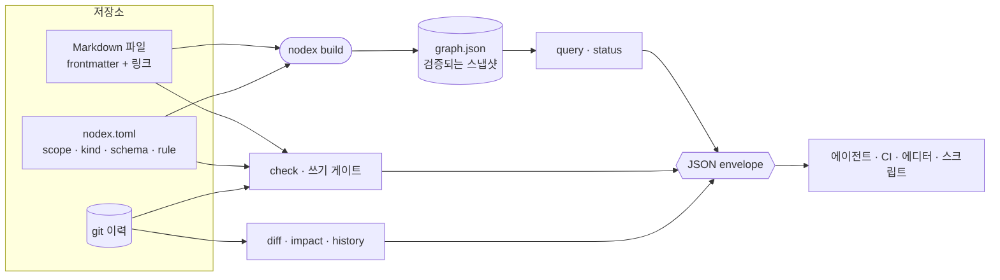
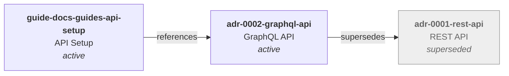
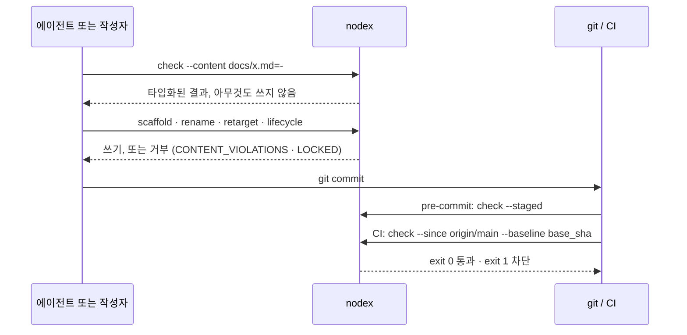

[](https://www.rust-lang.org)
[](LICENSE)

# nodex

> **[English](README.md)** | **한국어**

**Markdown 문서를 조회하고 검증할 수 있는 그래프로 — 에이전트, CI, 사람 모두를 위해.**

nodex는 Markdown 파일의 frontmatter와 링크를 읽어 문서 그래프를 만들고, 그 그래프에 대한 구조적 질문에 답합니다. 이 결정을 무엇이 대체했는지, 무엇이 이 문서를 인용하는지, 변경이 무엇을 깨뜨리는지, 제안된 편집이 유효한지를 묻습니다. 모든 답은 로컬 Rust 바이너리 하나가 내는 JSON envelope이고, 프로젝트별 규칙은 모두 `nodex.toml`에 둡니다.

- [왜 nodex인가](#왜-nodex인가) · [동작 방식](#동작-방식) · [빠른 시작](#빠른-시작) · [워크스루](#워크스루-파일에서-답까지)
- [작업 흐름](#작업-흐름) · [명령](#명령) · [JSON 계약](#json-계약) · [설정](#설정) · [설치](#설치) · [업그레이드](#업그레이드)

명령과 키의 자세한 설명은 Claude Code skill과 함께 배포되는 [명령 참고 문서](.claude/skills/nodex/reference/commands.md)와 [설정 참고 문서](.claude/skills/nodex/reference/config.md)에 있습니다.

---

## 왜 nodex인가

문서는 그래프입니다. 결정이 결정을 대체하고, 가이드가 결정을 인용하고, 규칙이 spec을 구현합니다. 그 그래프는 frontmatter와 링크 안에 있어서 `grep`으로는 보이지 않습니다.

| 질문 | nodex의 답 |
|---|---|
| 이 ADR을 무엇이 대체했나? | `query chain` — 어느 멤버에서 시작해도 전체 대체 계보 |
| 무엇이 이 문서를 인용하나? | `query backlinks` — frontmatter와 본문을 가리지 않는 모든 incoming edge |
| 이 편집을 쓰기 전에 유효한가? | `check --content` — 제안을 그 자리에서 판정, 타입화된 결과, 아무것도 쓰지 않음 |
| 이 변경이 무엇을 깨뜨렸나? | `impact <a> <b>` — 바뀐 문서, 그 dependent, 끊어진 참조 |
| 삭제된 그 문서는 뭐라고 했나? | `history <id>` — 마지막 판과, 그 문서를 추가하고 삭제한 커밋 |
| 고립되거나 낡은 문서는? | `query orphans`, `query stale`, `query issues` |

- **코드가 아니라 설정** — kind, status, id, 스키마, 링크, 잠금을 `nodex.toml`에 선언합니다.
- **타입화된 JSON 계약** — `{ok, data, warnings}` 또는 `{ok, error: {code, message}}`이고, 명령마다 JSON Schema를 발행합니다.
- **조언이 아니라 게이트** — 쓰기, 커밋, CI 범위를 `check`와 같은 규칙으로 판정합니다.
- **정직한 결과** — 모든 검사가 각 룰이 무엇을 얼마나 검사했는지 함께 알려 주므로, 빈 결과가 공허한 통과로 보이지 않습니다.
- **로컬에서 빠르게** — 바이너리 하나, 데몬이나 네트워크 없음, 증분·병렬 파싱.

---

## 동작 방식



각 문서는 `id`, `kind`, `status`를 가진 node가 됩니다. 이 값은 frontmatter에 선언하거나 `[identity]` 규칙이 경로에서 추론합니다. Edge는 frontmatter(`supersedes`, `superseded_by`, `implements`, `related`, `covers`, 그리고 직접 선언한 관계)와 본문(Markdown 링크, 선택적인 `[[wikilink]]`, 직접 선언한 패턴)에서 나옵니다. 어디로도 해석되지 않는 링크는 원인과 함께 미해결 참조로 그래프에 남습니다.

조회는 스냅샷에서 답하고, 스냅샷이 작업 트리와 어긋나면 낡은 답을 내는 대신 `GRAPH_OUTDATED`로 거부합니다. `check`와 쓰기 명령은 작업 트리에서 직접 빌드합니다.

---

## 빠른 시작

```bash
curl -fsSL https://raw.githubusercontent.com/junyeong-ai/nodex/main/scripts/install.sh | bash

nodex init                       # 주석이 달린 nodex.toml 생성
nodex build                      # 문서를 그래프로 파싱
nodex query search "auth"        # id / title / tag 순위 검색
nodex query backlinks <node-id>  # 문서를 가리키는 것
nodex check                      # 프로젝트 전체 룰 검사, error가 있으면 exit 1
```

모든 명령은 JSON을 출력합니다(clap의 `--help` / `help` / `--version` 제외). `--pretty`를 붙이면 들여씁니다.

---

## 워크스루: 파일에서 답까지

파일 세 개가 있습니다. 옛 API 결정, 그것을 대체한 결정, 그리고 현재 결정을 인용하는 가이드입니다.

```text
docs/
├── decisions/
│   ├── 0001-rest-api.md      # 옛 결정, 지금은 대체됨(superseded)
│   └── 0002-graphql-api.md   # 그것을 대체한 결정
└── guides/
    └── api-setup.md          # 현재 결정을 링크
```

```markdown
---
title: REST API
status: superseded
superseded_by: adr-0002-graphql-api
created: 2025-01-10
---
# REST API
원래 API 설계.
```

```markdown
---
title: GraphQL API
status: active
created: 2025-01-20
---
# GraphQL API
현재 API 설계.
```

```markdown
---
title: API Setup
status: active
created: 2025-02-01
---
# API Setup
[GraphQL API decision](../decisions/0002-graphql-api.md)에서 시작하세요.
```

`nodex.toml`이 이 파일들을 어떻게 읽을지 정합니다.

```toml
[scope]
include = ["docs/**/*.md"]         # docs 트리만 스캔; 다른 곳의 임시 draft는 scope 밖

[kinds]
allowed = ["generic", "adr", "guide"]

[statuses]
allowed = ["active", "superseded"]
terminal = ["superseded"]

[[identity.kind_rules]]            # docs/decisions/ 아래 파일은 ADR
glob = "docs/decisions/**"
kind = "adr"
[[identity.kind_rules]]            # docs/guides/ 아래 파일은 guide
glob = "docs/guides/**"
kind = "guide"
[[identity.id_rules]]              # ADR의 id는 "adr-<파일명>"
kind = "adr"
template = "adr-{stem}"

[schema]
required = ["created"]             # 모든 문서는 created 날짜 필수
cross_field = [{ when = "status=superseded", require = "superseded_by" }]
```

**1. 그래프를 빌드합니다.**

```jsonc
$ nodex build --pretty
{ "ok": true, "data": {
  "nodes": 3, "edges": 2, "annotations": 0, "body_line_matches": 0,
  "cached": 0, "parsed": 3, "duration_ms": 1
} }
```



**2. REST API 결정을 무엇이 대체했나?** 어느 멤버에서 시작해도 오래된 순서의 계보가 나옵니다.

```jsonc
$ nodex query chain adr-0001-rest-api --pretty
{ "ok": true, "data": { "items": [
  { "id": "adr-0001-rest-api",    "title": "REST API",     "status": "superseded", ... },
  { "id": "adr-0002-graphql-api", "title": "GraphQL API",  "status": "active",     ... }
], "total": 2 }, "snapshot": {
  "verification": "content", "unbuildable": 0, "unfollowed": 0
} }
```

계보는 갈라질 수 있으므로, 현재 문서는 위치가 아니라 `status`로 판단합니다.

**3. 현재 결정을 무엇이 가리키나?**

```jsonc
$ nodex query backlinks adr-0002-graphql-api --pretty
{ "ok": true, "data": { "items": [
  { "id": "guide-docs-guides-api-setup", "relation": "references", "location": "L7", ... }
], "total": 1 }, "snapshot": {
  "verification": "content", "unbuildable": 0, "unfollowed": 0
} }
```

**4. 전체를 검증합니다.**

```jsonc
$ nodex check --pretty
{ "ok": true, "data": {
  "violations": [ {
    "rule_id": "orphan", "severity": "warning",
    "node_id": "guide-docs-guides-api-setup", "path": "docs/guides/api-setup.md",
    "message": "no document references this one; link it, set `orphan_ok: true`, or add its kind to [detection].orphan_ok_kinds",
    "details": { "type": "orphan" }
  } ],
  "skipped_rules": [],
  "rule_coverage": [
    { "rule_id": "acyclic_relation", "unit": "edges", "subjects": 0, "unjudged": 0 },
    ...
    { "rule_id": "required_field",   "unit": "nodes", "subjects": 3, "unjudged": 0 },
    ...
  ],
  "total": 1, "has_errors": false
} }
```

결과 하나가 경고뿐이므로 exit 0입니다. `rule_coverage`는 각 룰이 얼마나 검사했는지 알려 줍니다. `acyclic_relation`은 `implements` edge를 검사하는데, 이 문서들에는 그런 edge가 없습니다.

**5. 쓰기 전에 편집을 게이트합니다.** 에이전트가 `created` 날짜 없이 새 ADR 초안을 만들었습니다.

```jsonc
$ nodex check --content docs/decisions/0003-grpc-api.md=draft.md --pretty
{ "ok": true, "data": {
  "violations": [
    { "rule_id": "orphan", "severity": "warning", "node_id": "adr-0003-grpc-api", ... },
    {
      "rule_id": "required_field", "severity": "error",
      "node_id": "adr-0003-grpc-api", "path": "docs/decisions/0003-grpc-api.md",
      "message": "missing required field: created",
      "details": { "type": "required_field", "field": "created" }   // ← 산문이 아니라 타입화
    }
  ],
  "skipped_rules": [],
  "rule_coverage": [ ..., { "rule_id": "required_field", "unit": "nodes", "subjects": 4, "unjudged": 0 }, ... ],
  "total": 2,
  "has_errors": true,
  "proposals": [ { "path": "docs/decisions/0003-grpc-api.md", "in_scope": true, "has_path_errors": true } ],
  "standing": [ { "rule_id": "orphan", "severity": "warning", "node_id": "adr-0003-grpc-api", ... } ]
} }
```

exit 1이고 아무것도 쓰지 않았습니다. 에이전트는 `details.field == "created"`를 읽어 날짜를 넣고 다시 검사합니다. 메시지를 파싱할 필요가 없습니다.

---

## 작업 흐름

### 모든 편집, 커밋, 범위를 게이트



- `check --content <path>=<source>`는 제안 바이트(`-`는 stdin)를 작업 트리에 겹쳐 놓고, 제안이 새로 만드는 위반에서 실패합니다. `--content` 쌍을 여러 개 주면 하나의 변경으로 판정합니다.
- 쓰기 명령도 쓰기 전에 같은 질문을 합니다. `scaffold`, `rename`, `retarget`은 `--dry-run`을 받아, 모든 게이트를 실행하고 아무것도 쓰지 않습니다.
- `check --staged`는 다음 커밋이 기록할 내용을, index에 담긴 `nodex.toml`로 판정합니다.

  ```sh
  #!/bin/sh
  # .git/hooks/pre-commit
  exec nodex check --staged
  ```

- `check --since <ref>`는 보고를 범위가 바꾼 것으로 좁히고, status 이동은 커밋마다 판정합니다. CI에서는 `fetch-depth: 0`으로 checkout합니다.

### 정착된 기록을 잠그기

잠금(lock)은 정착된 기록의 필드나 본문이 바뀌지 않게 하고, status flow는 kind가 할 수 있는 이동을 선언합니다.

```toml
[rules]
immutable_baseline = "origin/main"     # 잠금이 비교하는 기준
immutable_baseline_mode = "merge_base"

[[rules.body_immutable]]               # 결정의 본문은 커밋된 뒤 고정
name = "adr-decisions"
mode = "frozen"
trigger = "creation"
kinds = ["adr"]

[[statuses.flow]]
kinds = ["adr"]
initial = "proposed"
transitions = { proposed = ["active"], active = ["superseded", "archived"] }
```

잠금을 어기는 쓰기는 잠금 이름과 해결 방법을 담은 `LOCKED`로 거부됩니다. CI는 이벤트의 기준 커밋을 `--baseline <ref>`로 넘깁니다. 그러면 판정이 fetch한 브랜치의 위치가 아니라 판정 대상 커밋을 따릅니다. `nodex export rules`는 잠금마다 무장하는 status(`arms_at`)를 보여 줍니다. 자세히: [잠금과 trigger](.claude/skills/nodex/reference/config.md#diff-aware-rules), [status flow](.claude/skills/nodex/reference/config.md#status-flow).

### 문서를 지워도 잃지 않기

퇴역한 문서를 지우고 git 이력에만 남기는 프로젝트가 있습니다. `nodex history <id>`(또는 `--path <file>`)는 삭제된 문서를 마지막 판 그대로, 추가하고 삭제한 커밋과 함께 돌려줍니다. 둘 다 주지 않으면 작업 트리에 id가 더는 없는 문서를 모두 돌려줍니다. 미해결 참조 정책은 삭제된 문서를 가리키는 인용과 오타를 구분할 수 있습니다.

```toml
[[detection.unresolved_policy]]   # 결정 기록은 당시에 있던 것을 인용해도 됨
name = "record-cites-removed"
cause = "missing"
source_kinds = ["adr"]
history = "recorded"
severity = "info"

[[detection.unresolved_policy]]   # 살아 있는 문서는 안 됨
name = "living-cites-removed"
cause = "missing"
history = "recorded"
severity = "error"
```

`history` 행은 전체 이력이 필요합니다(`fetch-depth: 0`). shallow clone에서는 `check`, `query issues`, `migrate`를 뺀 쓰기 명령이 `CONFIG_ERROR`로 거부되고, 나머지 명령은 그대로 실행됩니다. [정책 행](.claude/skills/nodex/reference/config.md#unresolved-reference-policy).

### 그래프 없이 답하기

`nodex classify <path>...`는 빌드 없이 경로마다 scope가 문서를 받는지, 아무것도 선언하지 않은 문서가 그곳에서 갖게 될 kind, id, status를 알려 줍니다.

---

## 명령

| 명령 | 답하는 것 |
|---|---|
| `nodex init` | 주석이 달린 `nodex.toml` 생성 |
| `nodex build [--full]` | 그래프 스냅샷 빌드, `--full`은 캐시 무시 |
| `nodex status` | 스냅샷이 작업 트리와 일치하는지 |
| `nodex classify <path>...` | 그래프 없이 경로별 scope 판정과 추론 kind, id, status |
| `nodex check` | 등록된 모든 룰, `--content`, `--staged`, `--since <ref>`, `--baseline <ref>` |
| `nodex report` | 읽기 쉬운 요약 `GRAPH.md` 작성 |
| `nodex diff <a> <b>` | 두 git ref 사이에 바뀐 node, edge, status, field, 경로 |
| `nodex impact <a> <b>` | diff에 더해 각 변경의 dependent와 끊어진 참조 |
| `nodex history [<id>]` | 이력이 가졌고 프로젝트가 더는 갖지 않은 문서: 그 id로, `--path`로, 또는 전부 |
| `nodex query search <kw>` | id, title, tag 순위 검색과 필드별 점수 |
| `nodex query nodes` | kind, status, tag, field, 본문 필터에 맞는 문서 |
| `nodex query node <id>` | 문서 하나와 그 edge, 요청 시 본문 |
| `nodex query backlinks <id>` | 문서로 들어오는 모든 edge |
| `nodex query chain <id>` | 오래된 순서의 대체 계보 |
| `nodex query dependents <id>` | `--depth` 안에서 그 문서에 닿는 것 |
| `nodex query neighborhood <id>` | 양방향 N hop 안의 모든 것 |
| `nodex query components` | 연결 요소, 큰 순서 |
| `nodex query orphans` | 아무것도 참조하지 않는 살아 있는 문서 |
| `nodex query stale` | 검토 기한이 지난 살아 있는 문서 |
| `nodex query recent` | 날짜 필드가 구간 안에 드는 문서 |
| `nodex query similar` | 문서나 초안 제목의 비교 후보 |
| `nodex query covered-by <path>` | `covers:`가 코드 경로를 주장하는 문서 |
| `nodex query annotations` | 선언한 본문 마커, 묶어서 |
| `nodex query issues` | orphan, stale 문서, 미해결 참조, 룰 위반 |
| `nodex scaffold` | 유효한 frontmatter를 가진 새 문서 |
| `nodex rename <old> <new>` | 문서를 옮기고 참조를 고침 |
| `nodex retarget <old> <new>` | 참조를 다른 id로, `--supersede`는 옛 문서도 대체 처리 |
| `nodex lifecycle supersede <id>` | 문서를 `--to` 후속 문서로 대체됨 처리 |
| `nodex lifecycle set <id>` | kind가 허용하는 `--status`로 변경 |
| `nodex lifecycle review <id>` | 오늘을 검토일로 기록 |
| `nodex migrate` | frontmatter 없는 Markdown에 frontmatter 계획, `--apply`로 작성 |

도구와 코드 생성을 위한 매니페스트입니다. 의존 방향은 한쪽입니다. nodex가 내보내고 도구가 소비합니다.

```bash
nodex export schema            # 프로젝트 frontmatter의 JSON Schema
nodex export enums             # kind, status, 필드별 enum
nodex export rules             # 등록된 룰과 파라미터
nodex export config            # 해석된 scope, parser, identity, output
nodex export envelope-schema   # 모든 명령 payload의 JSON Schema (codegen)
nodex export commands          # 모든 leaf, positional, flag
nodex export diagnostics       # 오류, 경고, 종료 코드
```

전역 플래그: `-C <dir>`, `--pretty`, `--jobs <n>`, `--check-version <semver-req>`, `--today <YYYY-MM-DD>`.

---

## JSON 계약

```jsonc
{ "ok": true,  "data": { ... }, "warnings": [ { "code": "...", "message": "...", "details": { ... } } ] }
{ "ok": false, "error": { "code": "ERROR_CODE", "message": "..." } }
```

- `warnings`는 비어 있으면 생략합니다. 스냅샷 조회는 읽기가 무엇을 검증했는지 담은 `snapshot`을 더합니다.
- 목록은 `{items, total}`을 돌려줍니다. `--limit`으로 잘리면 `returned`가 붙으므로, 잘린 답이 완전한 답으로 보이지 않습니다.
- 종료 코드는 `0` 성공, `1` `check`가 error 위반을 찾음, `2` 오류 envelope 또는 실패한 배치 쓰기 또는 stdout이 받지 못한 출력입니다.
- 메시지가 아니라 `code`와 `details`로 분기합니다. 릴리즈마다 `nodex-envelope-schema-v<ver>.json`과 `nodex-commands-v<ver>.json`을 발행하고, 릴리즈 CI는 필요한 버전 올림 없는 계약 변경을 거부합니다.

<details>
<summary><b>오류 코드</b></summary>

<!-- published:error-codes -->

| 코드 | 원인 |
|---|---|
| `CYCLE_DETECTED` | `supersedes` cycle |
| `DUPLICATE_ID` | 동일 node id가 두 문서에 |
| `PARSE_ERROR` | 쓰기 명령이 frontmatter가 파싱되지 않는 문서(`lifecycle`은 frontmatter가 없는 문서도: `nodex migrate --apply`가 만들어 줌)를 만났거나, `graph.json`이 손상됨(`nodex build --full`) — build는 깨진 문서를 `parse_failure` 위반으로 기록 |
| `INVALID_TRANSITION` | `lifecycle` 액션이 허용 안 되는 status에서 시도됨 |
| `NOT_FOUND` | 참조한 node id가 그래프에 없음 |
| `GRAPH_MISSING` | `graph.json` 스냅샷 없이 `query` 실행 — `nodex build` 먼저 |
| `GRAPH_OUTDATED` | 조회가 스냅샷이 설정, scope 멤버십, (기본 모드에서는) 문서 내용과 어긋났음을 확인했거나, 요청한 본문이 색인된 리비전과 다르거나, 스냅샷 스키마가 호환되지 않음 — `nodex build`로 재생성(스키마 불일치는 `--full`) |
| `WRITE_CONFLICT` | 변경 명령이 문서를 읽은 뒤 그 문서가 바뀜. 현재 리비전을 다시 읽고 재시도 |
| `ALREADY_EXISTS` | `init` / `scaffold` / `rename` 대상 경로에 실제 파일이 이미 존재 |
| `PATH_ESCAPES_ROOT` | `..` / 심볼릭 링크가 프로젝트 루트를 벗어남 |
| `SYMLINK_TARGET` | 쓰려는 대상의 마지막 경로 구성요소가 심볼릭 링크여서 거부됨. nodex는 링크를 따라가며 쓰지 않음 |
| `CONTENT_VIOLATIONS` | 쓰기 게이트가 쓰기를 거부: 쓰려는 내용이 Error-severity `check` 위반을 새로 만듦 (각각 `path: rule_id: message`로 나열) |
| `LOCKED` | 쓰기가 활성화된 불변 잠금이 고정한 부분을 바꾸려 하거나, 잠금이 고정한 부분에서 문서가 이미 baseline과 달라져 있음. 메시지가 잠금과 그 부분을 밝히고 해결 방법을 알려 줌: `nodex check`가 보고하는 drift는 되돌리고, 고정된 부분은 바꾸지 않고 기록을 supersede함 |
| `CONFIG_ERROR` | `nodex.toml`이 로드 시점 검증에 실패했거나, 이번 실행이 따를 수 없는 것을 선언함: 잠금이 읽는 `rules.immutable_baseline`이 git이 해석하지 못하는 ref를 가리킴, git 없이 `detection.git_drift_threshold`를 설정함, `unresolved_policy` 행이 shallow clone에 없는 이력을 읽음, kind가 `superseded`를 허용하지 않는데 `lifecycle supersede`를 실행함 |
| `IO_ERROR` | filesystem read/write 실패 |
| `VERSION_MISMATCH` | 실행 바이너리가 버전 요구사항을 벗어남 — `--check-version <req>` 플래그(모든 명령) 또는 `[meta] nodex_version` pin 아래의 쓰기 명령 |
| `GIT_ERROR` | `git` 호출 실패 또는 거부 (work tree 없음, ref 부재, 충돌이 남은 index, `nodex history`가 읽을 수 없는 shallow clone 등) — 주로 `diff` / `impact` / `history` / `check --since` / `check --staged`에서 발생 |
| `INVALID_ARGUMENT` | 명령이 인자를 처리할 수 없음: clap 파싱 실패, config에 선언되지 않은 값(`--fields`, `--where`, `--name`, `--kind`, `--relations`, kind가 허용하지 않는 `lifecycle set --status`), 형식이 틀리거나 0인 값(`=` 없는 `--content`, `--depth 0`, `--limit 0`, SemVer가 아닌 `--check-version`), scope가 그래프에 넣지 않을 경로나 파일시스템과 표기가 다른 경로, 잠금이 읽는 `--baseline` 중 git이 해석하지 못하거나 `HEAD`와 merge base가 하나로 정해지지 않는 ref, 디렉터리 `rename`, `retarget X X`. 메시지가 무엇을 받는지 알려 주므로 인자나 메시지가 가리키는 선언을 고침 |
| `INTERNAL_ERROR` | nodex의 결함: 분류되지 않은 원인, 또는 nodex 자체 출력의 불변식 위반 |

<!-- /published:error-codes -->

</details>

<details>
<summary><b>경고 코드</b></summary>

경고는 결과의 범위, 보존 조건 등을 설명합니다. 경고만으로 성공을 판단하지 말고 종료 코드와 결과를 함께 확인합니다.

<!-- published:warning-codes -->

| 코드 | 의미 |
|---|---|
| `scope_coverage` | 읽은 것과 프로젝트가 관할하는 것이 어긋남 — 아무것도 고르지 않은 선언(어떤 파일과도 일치하지 않는 `scope.include`·`identity` glob, 아무것도 막지 않은 `scope.exclude`), 어느 `identity.kind_rules` glob에도 분류되지 않는 문서, walk가 읽지 못한 트리 부분, scope가 받지 않는 `check --content` 경로 |
| `snapshot_divergence` | 스냅샷 변경 또는 최신성 검사 실패 — 변경 시 재빌드, 검사 실패 시 메시지에 표시된 원인 해결 |
| `violations_introduced` | 쓰기가 새로 만든 Error-severity 위반을 거부하지 않고 쓴 채로 알림: 설정 기본값만으로 만든 `scaffold`에서 새 문서의 위반은 채워야 할 자리표시임 (위반마다 경고 하나) |
| `id_changed` | 쓰기 뒤 문서의 id가 바뀜: 경로에서 도출한 id를 고정할 frontmatter가 없는 문서를 `rename`함. 옛 id를 가리키는 참조는 더 이상 이 문서로 해석되지 않고, baseline에는 새 id의 기록이 없음 |
| `binary_compat` | 바이너리가 `[meta] nodex_version` 핀 밖 — 읽기는 실행, 쓰기는 거부 |
| `gate_suppression` | 나열된 위반이 판정한 집합과 다름(`--severity`, 또는 프로젝트를 담지 않은 `--since` ref); `has_errors`와 exit code는 판정한 위반 전체에 대해 답함 |
| `baseline_inert` | 기준으로 삼은 git ref에 조회한 대상이 없음 — 잠금 미적용, 한 문서에 대해 비활성, 또는 `diff` / `impact` 비교의 한쪽에 경로가 없음 |
| `ranking_unscored` | 점수가 없는 후보를 랭킹에서 빼고 그 수를 셈 |
| `file_skipped` | 편집이 뜻대로 되지 않음 — 무언가가 막았거나, 옮긴 참조가 이제 다른 문서를 가리키거나 아무것도 가리키지 않음 |
| `reference_kept` | 선언된 retarget 정책 또는 자기 참조 방지를 위해 참조를 보존함 |
| `document_evicted` | 쓰기가 `conditional_exclude` 부모를 terminal로 만들어 그 sub-artifact를 프로젝트에서 뺌 |
| `history_unread` | step 룰이 판정에 필요한 이력을 읽지 못함 — 빌드가 트리를 거부하는 커밋, 또는 shallow clone이 가져오지 않은 이력; 그 기록은 `unjudged`로 셈 |
| `threshold_undeclared` | `[detection].stale_days` 없이 `query stale`을 실행한 경우처럼, 프로젝트가 선언하지 않은 탐지 기준을 묻는 목록은 아무것도 측정하지 않음. 그래서 빈 답이 깨끗한 결과라는 뜻이 아님 |
| `cache` | 캐시를 읽거나 저장하지 못함; 다음 실행이 그 작업을 다시 함 |

<!-- /published:warning-codes -->

</details>

---

## 설정

`nodex init`이 주석이 달린 시작 파일을 씁니다. 로드할 때 파일 전체를 검증하고, 일관되지 않으면 어떤 명령도 실행하기 전에 `CONFIG_ERROR`로 거부합니다. 프로젝트가 무엇으로 해석됐는지는 `nodex export config`와 `nodex export rules`가 보여 줍니다. 모든 키: [설정 참고 문서](.claude/skills/nodex/reference/config.md).

```toml
[scope]
include = ["docs/**/*.md", { glob = "specs/**/*.md", may_be_empty = true }, "README.md"]
exclude = ["docs/drafts/**"]
# terminal 부모의 sub-artifact를 제외합니다(build가 제외한 경로를 알려 줌):
# [[scope.conditional_exclude]]
# parent_glob = "specs/**/SPEC.md"
# child_glob = "specs/**/tasks/**"
# condition = "status_terminal"

[kinds]
allowed = ["generic", "guide", "readme", "adr", "spec", "learning"]

[statuses]
allowed = ["draft", "active", "superseded", "archived", "deprecated", "abandoned"]
terminal = ["superseded", "archived", "deprecated", "abandoned"]
initial = "draft"   # scaffold와 migrate가 쓰는 값; 생략하면 첫 번째 허용 status

[scaffold.paths]
adr = "docs/decisions/{stem}.md"
spec = "specs/{slug}/SPEC.md"

[[identity.kind_rules]]
glob = "docs/decisions/**"
kind = "adr"

[[identity.id_rules]]
kind = "adr"
template = "adr-{stem}"

[[parser.link_patterns]]
pattern = "@([A-Za-z0-9_./-]+\\.md)"
relation = "imports"

[rules]
severity = { unresolved_reference = "error" }
immutable_baseline = "HEAD"   # 일반 `check`가 아래 잠금을 마지막 커밋 기준으로 적용

[[rules.naming]]
glob = "docs/decisions/**"
pattern = "^\\d{4}-[a-z0-9-]+\\.md$"
sequential = true
unique = true

[[rules.frontmatter_immutable]]
name = "identity"
fields = ["kind"]
trigger = "creation"   # 기록이 따를 생명주기는 첫 커밋에서 정해짐

# 결정의 본문은 커밋된 뒤 고정:
# [[rules.body_immutable]]
# name = "adr-decisions"
# mode = "frozen"
# trigger = "creation"
# kinds = ["adr"]

# spec 결정 로그의 각 줄은 알려진 gate를 명시:
# [[rules.body_line]]
# name = "spec-decision-log"
# pattern = '''^- \*\*(?P<gate>[a-z-]+)\*\*'''
# kinds = ["spec"]
# enums.gate = ["scope", "design", "rollout", "ship"]

# `nodex query annotations`가 보여 주는 본문 마커:
# [[annotations]]
# name = "promotes"
# pattern = '''\[PROMOTES:\s*(?P<id>[\w-]+)\]'''
# key = "id"
# kinds = ["learning"]

[schema]
required = ["created"]
cross_field = [{ when = "status=superseded", require = "superseded_by" }]

[[schema.overrides]]
kinds = ["adr"]
required = ["decision_date"]   # 전역 required에 더해짐
types = { decision_date = "date" }
forbidden = ["covers"]         # 결정 기록은 살아 있는 코드를 설명하지 않음

[detection]
stale_days = 180
orphan_grace_days = 14
# 존재하지 않는 후속 문서는 이력이 아니라 결함:
# [[detection.unresolved_policy]]
# name = "dead-successor"
# cause = "id_not_found"
# relations = ["superseded_by"]
# severity = "error"

[output]
dir = "_index"
```

| 섹션 | 제어하는 것 |
|---|---|
| `[scope]` | 어떤 파일이 문서인지: `include` / `exclude`, `prune_dirs`, `follow_symlinks`, `conditional_exclude` |
| `[kinds]` / `[statuses]` | 허용 kind와 status, terminal status, `initial`, `[[statuses.flow]]` 생명주기 |
| `[identity]` / `[scaffold.paths]` | 경로가 kind와 id를 추론하는 방식, `scaffold`가 kind마다 만드는 위치 |
| `[parser]` | 선언한 frontmatter 관계, 본문 `link_patterns`, `extensions`, `wikilink_enabled` |
| `[schema]` | `required`, `types`, `enums`, `cross_field`, kind별 `overrides`, `mode`, `require_explicit` |
| `[rules]` | severity 승격, 잠금 baseline, `naming`, `frontmatter_immutable`, `body_immutable`, `body_line`, `acyclic_relations` |
| `[detection]` | stale, orphan, superseded 참조, `git_drift`, `unresolved_policy` 표 |
| `[[annotations]]` / `[output]` / `[report]` / `[similarity]` / `[search]` | 본문 마커, 산출물 위치, 보고서 한도, 순위 가중치 |
| `[meta]` | `nodex_version`: 프로젝트를 쓸 수 있는 바이너리 |

`[meta] nodex_version = ">=0.65, <0.66"`은 프로젝트를 **쓸** 수 있는 바이너리를 고정합니다. 범위 밖이면 읽기는 `binary_compat` 경고와 함께 실행되고, 쓰기는 `VERSION_MISMATCH`로 거부됩니다. `--check-version <req>`는 모든 명령을 거부합니다.

---

## 설치

```bash
# macOS / Linux
curl -fsSL https://raw.githubusercontent.com/junyeong-ai/nodex/main/scripts/install.sh | bash
```

```powershell
# Windows (PowerShell)
iwr -useb https://raw.githubusercontent.com/junyeong-ai/nodex/main/scripts/install.ps1 | iex
```

설치 스크립트는 검증된 prebuilt 바이너리를 `~/.local/bin`(Windows는 `%USERPROFILE%\.local\bin`)에 내려받고 Claude Code skill도 설치합니다. 위치는 `--skill user|project|none`(Windows는 `-Skill`) 또는 `NODEX_SKILL_LEVEL`로 정합니다. `scripts/uninstall.sh`(`uninstall.ps1`)가 둘 다 지웁니다. Prebuilt 대상: Linux x86_64 / arm64(정적 musl), macOS universal, Windows x86_64 / arm64.

소스에서: `./scripts/install.sh --from-source` 또는 `cargo install --path nodex-cli`. CI에서는 `nodex --check-version ">=0.65, <0.66" build`로 바이너리를 고정합니다.

---

## 업그레이드

업그레이드한 뒤 각 프로젝트에서 `nodex build --full`을 실행하고, `nodex export envelope-schema`로 클라이언트를 다시 생성합니다. 호환되지 않는 스냅샷은 조회가 두 스키마 버전을 밝히며 `GRAPH_OUTDATED`로 거부합니다. 각 [릴리즈 노트](https://github.com/junyeong-ai/nodex/releases)가 그 릴리즈의 호환성 변경과 필요한 조치를 적습니다.

<details>
<summary>0.55 이전 릴리즈에서</summary>

- 추론 id의 기본값이 `{kind}-{path_slug}`입니다. 이전 `{kind}-{stem}` 방식으로 추론된 id를 유지하려면, 모든 kind에 적용되는 id 규칙(`[[identity.id_rules]]`, `kind = "*"`, `template = "{kind}-{stem}"`)을 더 좁은 규칙 뒤에 선언하거나(첫 일치가 이김), 업그레이드 전에 각 문서의 현재 id를 frontmatter에 적습니다(이전 바이너리의 `migrate --apply`는 frontmatter가 없는 파일에만 씀). 재빌드만으로는 유지되지 않습니다.
- `[statuses.flow]`를 `[[statuses.flow]]`로 바꿉니다. 조회는 기본적으로 스냅샷 내용을 검증하고, `--allow-stale`은 멤버십만 확인합니다.
- scan 진단은 건너뛴 하위 트리가 아니라 walk가 닿은 항목을 다룹니다.

</details>

---

## 기여

`nodex-core`가 모든 로직을 갖고 `nodex-cli`는 얇은 JSON 래퍼입니다. 로컬 게이트는 `./scripts/check.sh`입니다. 각 crate의 `CLAUDE.md`와 `.claude/rules/`에 모듈 경계와 룰·명령을 추가하는 절차가 있습니다.

## 라이선스

MIT
