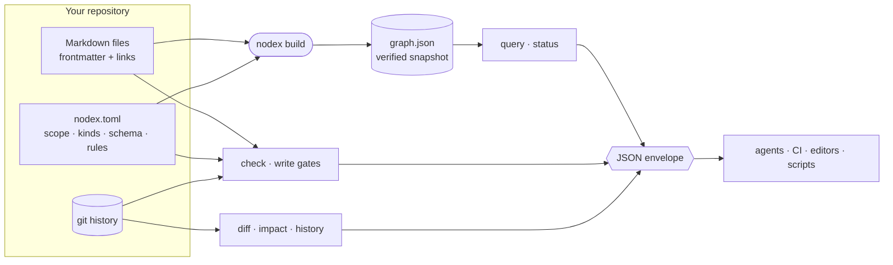
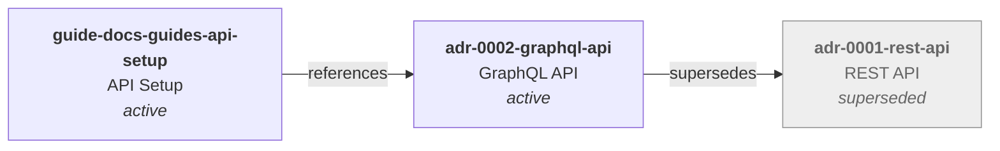
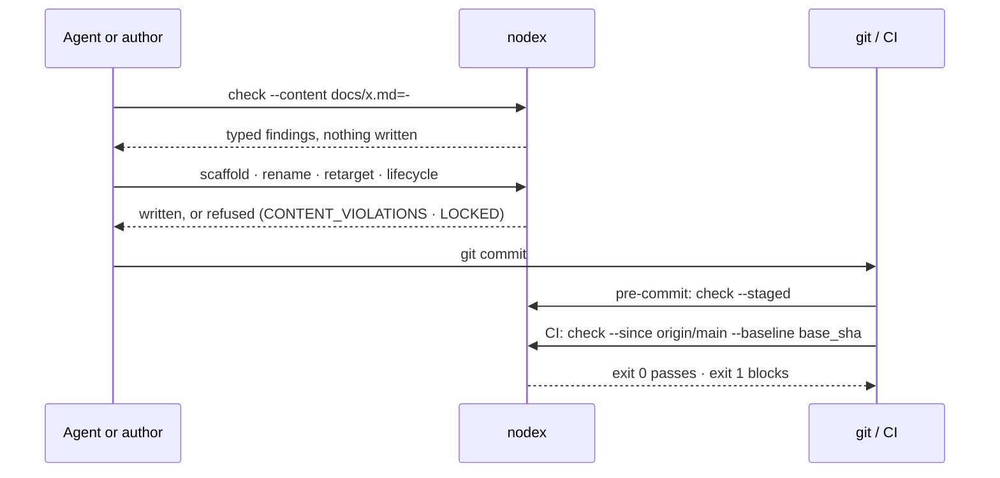

[](https://www.rust-lang.org)
[](LICENSE)

# nodex

> **English** | **[한국어](README.ko.md)**

**Your Markdown documents as a queryable, validated graph — for agents, CI and people.**

nodex reads the frontmatter and links of your Markdown files, builds a document graph, and answers structural questions about it: what replaced this decision, what cites it, what a change breaks, whether a proposed edit is valid. Every answer is a JSON envelope from one local Rust binary, and everything project-specific lives in `nodex.toml`.

- [Why nodex](#why-nodex) · [How it works](#how-it-works) · [Quick start](#quick-start) · [Walkthrough](#walkthrough-from-files-to-answers)
- [Workflows](#workflows) · [Commands](#commands) · [JSON contract](#json-contract) · [Configuration](#configuration) · [Install](#install) · [Upgrading](#upgrading)

Every command and key in depth: the [command reference](.claude/skills/nodex/reference/commands.md) and the [configuration reference](.claude/skills/nodex/reference/config.md), which ship with the Claude Code skill.

---

## Why nodex

Documentation is a graph: decisions supersede decisions, guides cite them, specs are implemented by rules. That graph lives in frontmatter and links, where `grep` cannot see it.

| Question | nodex answers with |
|---|---|
| What replaced this ADR? | `query chain` — the whole supersession lineage from any member |
| What cites this document? | `query backlinks` — every incoming edge, frontmatter and body alike |
| Is this edit valid before I write it? | `check --content` — the proposal judged in place, typed findings, nothing written |
| What did this change break? | `impact <a> <b>` — changed documents, their dependents, references left dangling |
| What did that removed document say? | `history <id>` — its last revision and the commits that added and removed it |
| Which documents are orphaned or stale? | `query orphans`, `query stale`, `query issues` |

- **Config, not code** — kinds, statuses, ids, schema, links and locks are declared in `nodex.toml`.
- **Typed JSON contract** — `{ok, data, warnings}` or `{ok, error: {code, message}}`, with a published JSON Schema per command.
- **Gates, not advice** — writes, commits and CI ranges are judged by the same rules as `check`.
- **Honest results** — every check reports how much each rule examined, so an empty finding list is never a vacuous pass.
- **Local and fast** — one binary, no daemon or network; incremental, parallel parsing.

---

## How it works



Each document becomes a node identified by `id`, `kind` and `status` — declared in frontmatter or inferred from its path by `[identity]` rules. Edges come from frontmatter (`supersedes`, `superseded_by`, `implements`, `related`, `covers`, and relations you declare) and from the body (Markdown links, optional `[[wikilinks]]`, and patterns you declare). A link that resolves to nothing stays on the graph as an unresolved reference with its cause.

Queries answer from the snapshot and refuse one that no longer matches the working tree (`GRAPH_OUTDATED`) instead of answering stale. `check` and the writing commands build from the working tree themselves.

---

## Quick start

```bash
curl -fsSL https://raw.githubusercontent.com/junyeong-ai/nodex/main/scripts/install.sh | bash

nodex init                       # writes an annotated nodex.toml
nodex build                      # parses the documents into the graph
nodex query search "auth"        # ranked id / title / tag matches
nodex query backlinks <node-id>  # what points at a document
nodex check                      # every rule over the project; exit 1 on errors
```

Every command prints JSON (clap's `--help` / `help` / `--version` aside); add `--pretty` to indent it.

---

## Walkthrough: From Files to Answers

Three files — an old API decision, the decision that replaced it, and a guide citing the current one:

```text
docs/
├── decisions/
│   ├── 0001-rest-api.md      # an old decision, now superseded
│   └── 0002-graphql-api.md   # the decision that replaced it
└── guides/
    └── api-setup.md          # links to the current decision
```

```markdown
---
title: REST API
status: superseded
superseded_by: adr-0002-graphql-api
created: 2025-01-10
---
# REST API
Our original API design.
```

```markdown
---
title: GraphQL API
status: active
created: 2025-01-20
---
# GraphQL API
The current API design.
```

```markdown
---
title: API Setup
status: active
created: 2025-02-01
---
# API Setup
Start from the [GraphQL API decision](../decisions/0002-graphql-api.md).
```

`nodex.toml` says how to read them:

```toml
[scope]
include = ["docs/**/*.md"]         # scan the docs tree; a scratch draft elsewhere stays out of scope

[kinds]
allowed = ["generic", "adr", "guide"]

[statuses]
allowed = ["active", "superseded"]
terminal = ["superseded"]

[[identity.kind_rules]]            # files under docs/decisions/ are ADRs
glob = "docs/decisions/**"
kind = "adr"
[[identity.kind_rules]]            # files under docs/guides/ are guides
glob = "docs/guides/**"
kind = "guide"
[[identity.id_rules]]              # an ADR's id is "adr-<filename>"
kind = "adr"
template = "adr-{stem}"

[schema]
required = ["created"]             # every doc must declare a created date
cross_field = [{ when = "status=superseded", require = "superseded_by" }]
```

**1. Build the graph.**

```jsonc
$ nodex build --pretty
{ "ok": true, "data": {
  "nodes": 3, "edges": 2, "annotations": 0, "body_line_matches": 0,
  "cached": 0, "parsed": 3, "duration_ms": 1
} }
```



**2. What replaced the REST API decision?** The lineage, oldest first, from any member:

```jsonc
$ nodex query chain adr-0001-rest-api --pretty
{ "ok": true, "data": { "items": [
  { "id": "adr-0001-rest-api",    "title": "REST API",     "status": "superseded", ... },
  { "id": "adr-0002-graphql-api", "title": "GraphQL API",  "status": "active",     ... }
], "total": 2 }, "snapshot": {
  "verification": "content", "unbuildable": 0, "unfollowed": 0
} }
```

A lineage can fork, so read which document is current from `status`, not from position.

**3. What points at the current decision?**

```jsonc
$ nodex query backlinks adr-0002-graphql-api --pretty
{ "ok": true, "data": { "items": [
  { "id": "guide-docs-guides-api-setup", "relation": "references", "location": "L7", ... }
], "total": 1 }, "snapshot": {
  "verification": "content", "unbuildable": 0, "unfollowed": 0
} }
```

**4. Validate the corpus.**

```jsonc
$ nodex check --pretty
{ "ok": true, "data": {
  "violations": [ {
    "rule_id": "orphan", "severity": "warning",
    "node_id": "guide-docs-guides-api-setup", "path": "docs/guides/api-setup.md",
    "message": "no document references this one; link it, set `orphan_ok: true`, or add its kind to [detection].orphan_ok_kinds",
    "details": { "type": "orphan" }
  } ],
  "skipped_rules": [],
  "rule_coverage": [
    { "rule_id": "acyclic_relation", "unit": "edges", "subjects": 0, "unjudged": 0 },
    ...
    { "rule_id": "required_field",   "unit": "nodes", "subjects": 3, "unjudged": 0 },
    ...
  ],
  "total": 1, "has_errors": false
} }
```

Exit 0: the one finding is a warning. `rule_coverage` says how much each rule examined — `acyclic_relation` guards `implements` edges, and this corpus has none.

**5. Gate an edit before it is written.** An agent drafts a new ADR without a `created` date:

```jsonc
$ nodex check --content docs/decisions/0003-grpc-api.md=draft.md --pretty
{ "ok": true, "data": {
  "violations": [
    { "rule_id": "orphan", "severity": "warning", "node_id": "adr-0003-grpc-api", ... },
    {
      "rule_id": "required_field", "severity": "error",
      "node_id": "adr-0003-grpc-api", "path": "docs/decisions/0003-grpc-api.md",
      "message": "missing required field: created",
      "details": { "type": "required_field", "field": "created" }   // ← typed, not prose
    }
  ],
  "skipped_rules": [],
  "rule_coverage": [ ..., { "rule_id": "required_field", "unit": "nodes", "subjects": 4, "unjudged": 0 }, ... ],
  "total": 2,
  "has_errors": true,
  "proposals": [ { "path": "docs/decisions/0003-grpc-api.md", "in_scope": true, "has_path_errors": true } ],
  "standing": [ { "rule_id": "orphan", "severity": "warning", "node_id": "adr-0003-grpc-api", ... } ]
} }
```

Exit 1, nothing written. The agent reads `details.field == "created"`, adds the date and checks again — no message parsing.

---

## Workflows

### Gate every edit, commit and range



- `check --content <path>=<source>` overlays proposed bytes (`-` for stdin) on the working tree and fails on what they introduce. Several `--content` pairs are judged as one change.
- The writing commands ask the same question before they write; `scaffold`, `rename` and `retarget` take `--dry-run`, which runs every gate and writes nothing.
- `check --staged` judges what the next commit records, under the `nodex.toml` the index carries:

  ```sh
  #!/bin/sh
  # .git/hooks/pre-commit
  exec nodex check --staged
  ```

- `check --since <ref>` narrows the report to what a range changed and judges status moves commit by commit; check out with `fetch-depth: 0` in CI.

### Lock what a record has settled

Locks keep a settled record's fields or body from changing; status flows declare which moves a kind may make.

```toml
[rules]
immutable_baseline = "origin/main"     # what locks compare against
immutable_baseline_mode = "merge_base"

[[rules.body_immutable]]               # a decision's body is frozen once committed
name = "adr-decisions"
mode = "frozen"
trigger = "creation"
kinds = ["adr"]

[[statuses.flow]]
kinds = ["adr"]
initial = "proposed"
transitions = { proposed = ["active"], active = ["superseded", "archived"] }
```

A violating write is refused with `LOCKED`, naming the lock and the remedy. CI passes the commit its event is measured from as `--baseline <ref>`, so the verdict follows the commits judged rather than where a fetched branch stood. `nodex export rules` lists each lock's `arms_at` statuses. Details: [locks and triggers](.claude/skills/nodex/reference/config.md#diff-aware-rules), [status flows](.claude/skills/nodex/reference/config.md#status-flow).

### Remove documents without losing them

A project can delete retired documents and keep them only in git history. `nodex history <id>` (or `--path <file>`) returns each removed document as its last revision reads, with the commits that added and removed it; with neither, every document whose id the working tree no longer holds. An unresolved-reference policy can then tell a citation of a removed document from a typo:

```toml
[[detection.unresolved_policy]]   # a decision record may cite what stood on its day
name = "record-cites-removed"
cause = "missing"
source_kinds = ["adr"]
history = "recorded"
severity = "info"

[[detection.unresolved_policy]]   # a living document may not
name = "living-cites-removed"
cause = "missing"
history = "recorded"
severity = "error"
```

A `history` row needs the whole history (`fetch-depth: 0`): in a shallow clone `check`, `query issues` and every write but `migrate` are refused with `CONFIG_ERROR`, and other commands still run. [Policy rows](.claude/skills/nodex/reference/config.md#unresolved-reference-policy).

### Answer without a graph

`nodex classify <path>...` tells a tool, before any build, whether the scope admits a document at each path and the kind, id and status one declaring none would take there.

---

## Commands

| Command | Answers |
|---|---|
| `nodex init` | Writes an annotated `nodex.toml` |
| `nodex build [--full]` | Builds the graph snapshot; `--full` ignores the cache |
| `nodex status` | Whether the snapshot matches the working tree |
| `nodex classify <path>...` | Scope verdict and inferred kind, id and status per path, without a graph |
| `nodex check` | Every registered rule; `--content`, `--staged`, `--since <ref>`, `--baseline <ref>` |
| `nodex report` | Writes `GRAPH.md`, a readable summary |
| `nodex diff <a> <b>` | Nodes, edges, statuses, fields and paths changed between two git refs |
| `nodex impact <a> <b>` | The diff plus each change's dependents and dangling references |
| `nodex history [<id>]` | Documents history held that the project no longer holds: under an id, at a `--path`, or all |
| `nodex query search <kw>` | Ranked id, title and tag matches with per-field scores |
| `nodex query nodes` | Documents matching kind, status, tag, field and body filters |
| `nodex query node <id>` | One document with its edges and, on request, its body |
| `nodex query backlinks <id>` | Every edge into a document |
| `nodex query chain <id>` | The supersession lineage, oldest first |
| `nodex query dependents <id>` | What reaches it within `--depth` hops |
| `nodex query neighborhood <id>` | Everything within N hops either way |
| `nodex query components` | Connected components, largest first |
| `nodex query orphans` | Live documents nothing references |
| `nodex query stale` | Live documents past their review threshold |
| `nodex query recent` | Documents whose date field falls in a window |
| `nodex query similar` | Comparison candidates for a document or a draft title |
| `nodex query covered-by <path>` | Documents whose `covers:` claims a code path |
| `nodex query annotations` | Declared body markers, grouped |
| `nodex query issues` | Orphans, stale documents, unresolved references and rule findings |
| `nodex scaffold` | A new document with valid frontmatter |
| `nodex rename <old> <new>` | Moves a document and rewrites references to it |
| `nodex retarget <old> <new>` | Repoints references; `--supersede` also supersedes the old one |
| `nodex lifecycle supersede <id>` | Marks a document superseded `--to` its successor |
| `nodex lifecycle set <id>` | Sets a `--status` its kind allows |
| `nodex lifecycle review <id>` | Records today as the review date |
| `nodex migrate` | Plans frontmatter for bare Markdown; `--apply` writes it |

Manifests for tools and code generation — the dependency runs one way, nodex emits and tools consume:

```bash
nodex export schema            # JSON Schema for the project's frontmatter
nodex export enums             # kinds, statuses, per-field enums
nodex export rules             # registered rules with their parameters
nodex export config            # resolved scope, parser, identity and output
nodex export envelope-schema   # JSON Schema of every command's payload (codegen)
nodex export commands          # every leaf, positional and flag
nodex export diagnostics       # error, warning and exit codes
```

Global flags: `-C <dir>`, `--pretty`, `--jobs <n>`, `--check-version <semver-req>`, `--today <YYYY-MM-DD>`.

---

## JSON contract

```jsonc
{ "ok": true,  "data": { ... }, "warnings": [ { "code": "...", "message": "...", "details": { ... } } ] }
{ "ok": false, "error": { "code": "ERROR_CODE", "message": "..." } }
```

- `warnings` is omitted when empty; snapshot queries add `snapshot`, what the read verified.
- Listings return `{items, total}`; a `--limit` cap adds `returned`, so a capped answer never reads as complete.
- Exit `0` success · `1` `check` found error-severity violations · `2` an error envelope, a batch write that failed, or output stdout would not take.
- Branch on `code` and `details`, never on message text. Every release publishes `nodex-envelope-schema-v<ver>.json` and `nodex-commands-v<ver>.json`, and release CI refuses a contract change without the version bump it needs.

<details>
<summary><b>Error codes</b></summary>

<!-- published:error-codes -->

| Code | Cause |
|---|---|
| `CYCLE_DETECTED` | A cycle exists in `supersedes` edges |
| `DUPLICATE_ID` | Two documents resolved to the same node id |
| `PARSE_ERROR` | A writing command met a document whose frontmatter does not parse — or, for `lifecycle`, has none (`nodex migrate --apply` writes one) — or `graph.json` is corrupt (`nodex build --full`); a build records a malformed document as a `parse_failure` violation instead |
| `INVALID_TRANSITION` | `lifecycle` action attempted from a status that doesn't allow it |
| `NOT_FOUND` | Referenced node id doesn't exist in the graph |
| `GRAPH_MISSING` | A `query` ran with no `graph.json` snapshot — run `nodex build` |
| `GRAPH_OUTDATED` | A query found the snapshot drifted from the configuration, the scope's membership or (by default) document content, a requested body does not match the indexed revision, or the snapshot schema is incompatible — rebuild with `nodex build` (`--full` for schema mismatch) |
| `WRITE_CONFLICT` | A document changed after the mutation read it; reread and retry against its current revision |
| `ALREADY_EXISTS` | `init` / `scaffold` / `rename` target path already occupies a real file |
| `PATH_ESCAPES_ROOT` | A path traversal (`..`) or symlink would escape the project root |
| `SYMLINK_TARGET` | A write was refused because its target's final component is a symlink: nodex never writes through one |
| `CONTENT_VIOLATIONS` | The write gate refused the write: what it would write introduces Error-severity `check` violations (each listed as `path: rule_id: message`) |
| `LOCKED` | A write would change what an armed immutability lock holds, or the document already differs from its baseline where one does. The message names the lock and the part, and says which remedy applies: revert a drift `nodex check` reports, or leave the frozen part unmade and supersede the record |
| `CONFIG_ERROR` | `nodex.toml` failed validation at load time, or declares what this run cannot honour: `rules.immutable_baseline` names a ref git cannot resolve while a lock reads it, `detection.git_drift_threshold` is set without git, an `unresolved_policy` row reads history a shallow clone does not hold, or `lifecycle supersede` writes `superseded` where the kind does not allow it |
| `IO_ERROR` | Filesystem read/write failure |
| `VERSION_MISMATCH` | The running binary fell outside a version requirement — either the `--check-version <req>` flag (every command) or a document-writing command under a `[meta] nodex_version` pin |
| `GIT_ERROR` | `git` failed or refused (e.g., not a work tree, missing ref, an index with unmerged entries, a shallow clone `nodex history` cannot read) — most often from `diff`, `impact`, `history`, `check --since` and `check --staged` |
| `INVALID_ARGUMENT` | The command cannot act on its arguments: a clap parse failure, a value the config does not declare (`--fields`, `--where`, `--name`, `--kind`, `--relations`, a `lifecycle set --status` the kind does not allow), a malformed or zero value (`--content` without `=`, `--depth 0`, `--limit 0`, a `--check-version` that is not SemVer), a path the scope would not graph or the filesystem spells differently, a `--baseline` a lock reads that git cannot resolve or that has no single merge base with `HEAD`, `rename` of a directory, `retarget X X`. The message names what is accepted; correct the argument or the declaration it points to |
| `INTERNAL_ERROR` | A defect in nodex: an unclassified cause, or an invariant of its own output that failed |

<!-- /published:error-codes -->

</details>

<details>
<summary><b>Warning codes</b></summary>

Warnings describe the result's scope, retention or other conditions; they do not establish success, so read the exit code and the result too.

<!-- published:warning-codes -->

| Code | Meaning |
|---|---|
| `scope_coverage` | What was read and what the project governs did not line up — a declaration that selected nothing (a `scope.include` or `identity` glob matching no file, a `scope.exclude` that kept nothing out), a document no `identity.kind_rules` glob classifies, a part of the tree the walk never read, or a `check --content` path the scope does not admit |
| `snapshot_divergence` | Snapshot drift or a failed freshness probe — rebuild for drift; resolve the probe error named in the message |
| `violations_introduced` | A write landed with Error-severity findings it introduced instead of refusing them: a `scaffold` from config defaults alone, whose findings on its new document are the placeholders to fill in (one warning per finding) |
| `id_changed` | A write left a document under a different id: `rename` of a document with no frontmatter to anchor its path-derived id in. References naming the old id no longer resolve to it, and the baseline holds nothing under the new one |
| `binary_compat` | The binary is outside the `[meta] nodex_version` pin — reads run, writes refuse |
| `gate_suppression` | The listed violations are not the set judged (`--severity`, or a `--since` ref that does not carry the project); `has_errors` and the exit code still answer for every violation judged |
| `baseline_inert` | A git ref leaned on had nothing where it was asked — locks not enforced, inert for one document, or one side of a `diff` / `impact` comparison missing a path |
| `ranking_unscored` | Candidates carrying no score were left out of a ranking, and counted |
| `file_skipped` | An edit did not land as meant — something stood in the way, or a moved reference now names another document or nothing |
| `reference_kept` | A mutation preserved a reference by its declared retarget policy or to avoid a self-reference |
| `document_evicted` | A write made a `conditional_exclude` parent terminal and so dropped its sub-artifacts from the project |
| `history_unread` | The step rules could not read history they needed — a commit whose tree the build refuses, or history a shallow clone cut off; its records are counted as `unjudged` |
| `threshold_undeclared` | A listing asked by a detection threshold the project does not declare measured nothing — `query stale` without `[detection].stale_days` — so its empty answer is not a clean one |
| `cache` | A cache could not be read or persisted; the next run redoes that work |

<!-- /published:warning-codes -->

</details>

---

## Configuration

`nodex init` writes an annotated starter. Loading validates the whole file and refuses an inconsistent one with `CONFIG_ERROR` before any command runs; `nodex export config` and `nodex export rules` show what a project resolved to. Every key: the [configuration reference](.claude/skills/nodex/reference/config.md).

```toml
[scope]
include = ["docs/**/*.md", { glob = "specs/**/*.md", may_be_empty = true }, "README.md"]
exclude = ["docs/drafts/**"]
# Drop a terminal parent's sub-artifacts; the build names what it drops:
# [[scope.conditional_exclude]]
# parent_glob = "specs/**/SPEC.md"
# child_glob = "specs/**/tasks/**"
# condition = "status_terminal"

[kinds]
allowed = ["generic", "guide", "readme", "adr", "spec", "learning"]

[statuses]
allowed = ["draft", "active", "superseded", "archived", "deprecated", "abandoned"]
terminal = ["superseded", "archived", "deprecated", "abandoned"]
initial = "draft"   # what scaffold and migrate write; omitted = the first allowed status

[scaffold.paths]
adr = "docs/decisions/{stem}.md"
spec = "specs/{slug}/SPEC.md"

[[identity.kind_rules]]
glob = "docs/decisions/**"
kind = "adr"

[[identity.id_rules]]
kind = "adr"
template = "adr-{stem}"

[[parser.link_patterns]]
pattern = "@([A-Za-z0-9_./-]+\\.md)"
relation = "imports"

[rules]
severity = { unresolved_reference = "error" }
immutable_baseline = "HEAD"   # a plain `check` enforces the locks below against the last commit

[[rules.naming]]
glob = "docs/decisions/**"
pattern = "^\\d{4}-[a-z0-9-]+\\.md$"
sequential = true
unique = true

[[rules.frontmatter_immutable]]
name = "identity"
fields = ["kind"]
trigger = "creation"   # which lifecycle a record answers to, settled by its first commit

# A decision's body is frozen once committed:
# [[rules.body_immutable]]
# name = "adr-decisions"
# mode = "frozen"
# trigger = "creation"
# kinds = ["adr"]

# Each line of a spec's decision log names a known gate:
# [[rules.body_line]]
# name = "spec-decision-log"
# pattern = '''^- \*\*(?P<gate>[a-z-]+)\*\*'''
# kinds = ["spec"]
# enums.gate = ["scope", "design", "rollout", "ship"]

# Body markers surfaced by `nodex query annotations`:
# [[annotations]]
# name = "promotes"
# pattern = '''\[PROMOTES:\s*(?P<id>[\w-]+)\]'''
# key = "id"
# kinds = ["learning"]

[schema]
required = ["created"]
cross_field = [{ when = "status=superseded", require = "superseded_by" }]

[[schema.overrides]]
kinds = ["adr"]
required = ["decision_date"]   # added on top of the global required set
types = { decision_date = "date" }
forbidden = ["covers"]         # a decision record does not describe live code

[detection]
stale_days = 180
orphan_grace_days = 14
# A successor that does not exist is a defect, not history:
# [[detection.unresolved_policy]]
# name = "dead-successor"
# cause = "id_not_found"
# relations = ["superseded_by"]
# severity = "error"

[output]
dir = "_index"
```

| Section | Controls |
|---|---|
| `[scope]` | Which files are documents: `include` / `exclude`, `prune_dirs`, `follow_symlinks`, `conditional_exclude` |
| `[kinds]` / `[statuses]` | Allowed kinds and statuses, terminal statuses, `initial`, `[[statuses.flow]]` lifecycles |
| `[identity]` / `[scaffold.paths]` | How a path infers kind and id; where `scaffold` creates each kind |
| `[parser]` | Declared frontmatter relations, body `link_patterns`, `extensions`, `wikilink_enabled` |
| `[schema]` | `required`, `types`, `enums`, `cross_field`, per-kind `overrides`, `mode`, `require_explicit` |
| `[rules]` | Severity promotions, the lock baseline, `naming`, `frontmatter_immutable`, `body_immutable`, `body_line`, `acyclic_relations` |
| `[detection]` | Staleness, orphans, superseded references, `git_drift`, the `unresolved_policy` table |
| `[[annotations]]` / `[output]` / `[report]` / `[similarity]` / `[search]` | Body markers, artifact location, report limits, ranking weights |
| `[meta]` | `nodex_version`: the binary that may write the project |

`[meta] nodex_version = ">=0.65, <0.66"` pins the binary that may **write** the project: outside it, reads run with a `binary_compat` warning and writes refuse with `VERSION_MISMATCH`. `--check-version <req>` refuses every command instead.

---

## Install

```bash
# macOS / Linux
curl -fsSL https://raw.githubusercontent.com/junyeong-ai/nodex/main/scripts/install.sh | bash
```

```powershell
# Windows (PowerShell)
iwr -useb https://raw.githubusercontent.com/junyeong-ai/nodex/main/scripts/install.ps1 | iex
```

The installer downloads a verified prebuilt binary to `~/.local/bin` (`%USERPROFILE%\.local\bin` on Windows) and installs the Claude Code skill — `--skill user|project|none` (`-Skill` on Windows) or `NODEX_SKILL_LEVEL` chooses where. `scripts/uninstall.sh` (`uninstall.ps1`) removes both. Prebuilt targets: Linux x86_64 / arm64 (static musl), macOS universal, Windows x86_64 / arm64.

From source: `./scripts/install.sh --from-source`, or `cargo install --path nodex-cli`. Pin the binary in CI with `nodex --check-version ">=0.65, <0.66" build`.

---

## Upgrading

Run `nodex build --full` in each project after upgrading, and regenerate clients from `nodex export envelope-schema`. Queries reject an incompatible snapshot with `GRAPH_OUTDATED`, naming both schema versions. Each [release's notes](https://github.com/junyeong-ai/nodex/releases) list the compatibility changes it makes and the steps they need.

<details>
<summary>From a release before 0.55</summary>

- Inferred ids default to `{kind}-{path_slug}`. To keep ids inferred under the earlier `{kind}-{stem}` fallback, give the catch-all id rule that template — `[[identity.id_rules]]` with `kind = "*"` and `template = "{kind}-{stem}"`, declared after any narrower rule because the first match wins — or write each document's current id into its frontmatter before upgrading (the previous binary's `migrate --apply` does so only for files without frontmatter); rebuilding alone does not preserve them.
- Convert `[statuses.flow]` to `[[statuses.flow]]`. Queries verify snapshot content by default; `--allow-stale` asks for a membership-only snapshot read.
- Scan diagnostics cover the entries a walk reaches rather than the subtrees it skips.

</details>

---

## Contributing

`nodex-core` holds all logic and `nodex-cli` is a thin JSON wrapper. `./scripts/check.sh` is the local gate; each crate's `CLAUDE.md` and `.claude/rules/` record the module boundaries and the procedures for adding a rule or a command.

## License

MIT
