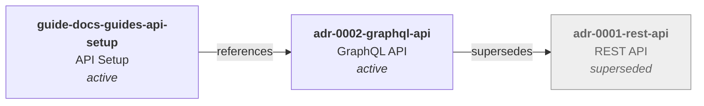
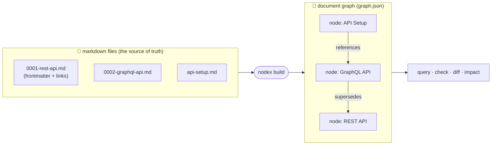
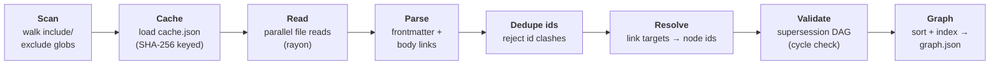

[](https://www.rust-lang.org)
[](LICENSE)

# nodex

> **English** | **[한국어](README.ko.md)**

**Turn markdown files into a queryable, validated document graph.**

nodex scans your project's markdown files, extracts YAML frontmatter and link relationships, and builds an immutable document graph you can search, validate, diff, and report on — all through a JSON-first CLI, from one Rust binary with a stable JSON contract.

---

## Table of Contents

1. [The Problem](#the-problem)
2. [Quick Start](#quick-start)
3. [Walkthrough: From Files to Answers](#walkthrough-from-files-to-answers) — build, query, check, and gate an edit on three files
4. [Core Concepts](#core-concepts) — files become a graph, edge types, frontmatter schema
5. [How It Works](#how-it-works) — build pipeline, verified snapshots
6. [Commands](#commands) — what each command answers
7. [JSON-First CLI](#json-first-cli) — envelope, exit, error and warning codes, global flags, manifests
8. [Validation](#validation) — built-in rules, gating edits and commits, locks and status flows, lifecycle
9. [Configuration](#configuration) — an example `nodex.toml` and what each section controls
10. [Architecture](#architecture) — workspace and design principles
11. [Install](#install)
12. [Upgrading](#upgrading)
13. [License](#license)

Per-command and per-key semantics live in the reference the Claude Code skill ships with: [commands](.claude/skills/nodex/reference/commands.md) and [configuration](.claude/skills/nodex/reference/config.md).

---

## The Problem

A project's documentation is rarely a flat pile of files — it's a graph. ADR-0002 supersedes ADR-0001. A runbook depends on a guide. A spec is implemented by three rules. But that graph lives implicitly in `[link text](paths.md)` and frontmatter fields, invisible to `grep` and `find`.

This makes routine questions hard to answer:

| Question | What `grep` does | What you actually need |
|---|---|---|
| "What replaced this ADR?" | nothing — supersession isn't text | The full supersession lineage from any member; the current doc is a live (non-terminal) tip (a fork can have several) |
| "What depends on this doc?" | finds files mentioning its name, misses `related:` frontmatter | All incoming edges, regardless of source |
| "Which docs still cite a replaced decision?" | finds the link, not that its target was replaced | Live citations of a terminal doc whose lineage continues, each naming the doc to cite instead |
| "Which docs are isolated?" | nothing — absence isn't searchable | Live docs nothing references — no incoming edge, no predecessor's `superseded_by` |
| "Which docs are stale?" | nothing — dates aren't compared | Live (non-terminal) docs whose last review passed the threshold |
| "What changed between these refs?" | line diff at best | Added / removed nodes, status transitions, field changes |
| "Find auth docs" | every file containing "auth" | Ranked by id / title / tag, each hit with its per-field score breakdown |

nodex makes the implicit graph explicit. It parses your markdown once, builds a typed graph with adjacency indices, and answers structural questions from that snapshot without re-parsing the markdown. Routine workflows — pre-commit validation, PR diff gating, comparison before authoring, vocabulary sync with external tooling — collapse into single JSON-emitting commands.

**Core properties:**

- **Graph, not folders** — supersession chains, backlinks, cross-references are first-class
- **Config, not code** — all project-specific rules live in `nodex.toml`; zero hardcoded domain logic
- **Incremental & parallel** — Rust + rayon parallel reads, SHA-256 per-file cache invalidates only what changed
- **JSON-first contract** — every operational command emits a stable envelope (`{ok, data, warnings}` / `{ok, error: {code, message}}`) with classified error codes
- **Pure CLI** — no daemons, no servers, no AI / network dependencies; everything is a synchronous local process

---

## Quick Start

```bash
# Install (macOS / Linux)
curl -fsSL https://raw.githubusercontent.com/junyeong-ai/nodex/main/scripts/install.sh | bash

# Initialize config in your project
nodex init

# Build the document graph
nodex build

# Search for documents
nodex query search "auth"

# Explore relationships
nodex query backlinks <node-id>
nodex query chain <node-id>

# Validate against the schema
nodex check

# Diff between git refs
nodex diff origin/main HEAD
```

Every command prints JSON (clap's `--help` / `help` / `--version` aside); add `--pretty` to indent it.

---

## Walkthrough: From Files to Answers

Say you have three markdown files — two architecture decisions (one replaced by the other) and a guide that links to the current decision:

```text
docs/
├── decisions/
│   ├── 0001-rest-api.md      # an old decision, now superseded
│   └── 0002-graphql-api.md   # the decision that replaced it
└── guides/
    └── api-setup.md          # links to the current decision
```

The old decision, `docs/decisions/0001-rest-api.md`:

```markdown
---
title: REST API
status: superseded
superseded_by: adr-0002-graphql-api
created: 2025-01-10
---
# REST API
Our original API design.
```

The current decision, `docs/decisions/0002-graphql-api.md`:

```markdown
---
title: GraphQL API
status: active
created: 2025-01-20
---
# GraphQL API
The current API design.
```

…and the guide links to the current decision under its heading:

```markdown
---
title: API Setup
status: active
created: 2025-02-01
---
# API Setup
Start from the [GraphQL API decision](../decisions/0002-graphql-api.md).
```

A minimal `nodex.toml` says how to read them (the [configuration reference](.claude/skills/nodex/reference/config.md) and the template `nodex init` writes describe every key):

```toml
[scope]
include = ["docs/**/*.md"]         # scan the docs tree; a scratch draft elsewhere stays out of scope

[kinds]
allowed = ["generic", "adr", "guide"]

[statuses]
allowed = ["active", "superseded"]
terminal = ["superseded"]

[[identity.kind_rules]]            # files under docs/decisions/ are ADRs
glob = "docs/decisions/**"
kind = "adr"
[[identity.kind_rules]]            # files under docs/guides/ are guides
glob = "docs/guides/**"
kind = "guide"
[[identity.id_rules]]              # an ADR's id is "adr-<filename>"
kind = "adr"
template = "adr-{stem}"

[schema]
required = ["created"]             # every doc must declare a created date
cross_field = [{ when = "status=superseded", require = "superseded_by" }]
```

**1. Build the graph** — scan the files once into an immutable graph:

```jsonc
$ nodex build --pretty
{ "ok": true, "data": {
  "nodes": 3, "edges": 2, "annotations": 0, "body_line_matches": 0,
  "cached": 0, "parsed": 3, "duration_ms": 1
} }
```

The result is a graph where the supersession and the body link are first-class edges:



**2. "What replaced the REST API decision?"** — `grep` can't answer this; a graph walk can:

```jsonc
$ nodex query chain adr-0001-rest-api --pretty
{ "ok": true, "data": { "items": [
  { "id": "adr-0001-rest-api",    "title": "REST API",     "status": "superseded", ... },
  { "id": "adr-0002-graphql-api", "title": "GraphQL API",  "status": "active",     ... }
], "total": 2 }, "snapshot": {
  "verification": "content", "unbuildable": 0, "unfollowed": 0
} }
//  oldest → newest — in this linear lineage the current doc is the last entry (the only `active`
//  tip): GraphQL replaced REST. Anchor on any member, even the current doc, for the whole lineage.
//  (supersedes is a DAG — a fork or consolidation can have several tips; read currency from
//  `status`, not position.)
```

**3. "What points at the current decision?"** — every incoming edge, regardless of where it came from:

```jsonc
$ nodex query backlinks adr-0002-graphql-api --pretty
{ "ok": true, "data": { "items": [
  { "id": "guide-docs-guides-api-setup", "relation": "references", "location": "L7", ... }
], "total": 1 }, "snapshot": {
  "verification": "content", "unbuildable": 0, "unfollowed": 0
} }   //  the guide links to it on line 7
```

**4. Validate the whole corpus** — schema, cross-field rules and the detection rules, all in one pass:

```jsonc
$ nodex check --pretty
{ "ok": true, "data": {
  "violations": [ {
    "rule_id": "orphan", "severity": "warning",
    "node_id": "guide-docs-guides-api-setup", "path": "docs/guides/api-setup.md",
    "message": "no document references this one; link it, set `orphan_ok: true`, or add its kind to [detection].orphan_ok_kinds",
    "details": { "type": "orphan" }
  } ],
  "skipped_rules": [],
  "rule_coverage": [
    { "rule_id": "acyclic_relation", "unit": "edges", "subjects": 0, "unjudged": 0 },
    ...
    { "rule_id": "required_field",   "unit": "nodes", "subjects": 3, "unjudged": 0 },
    ...
  ],
  "total": 1, "has_errors": false
} }
//  exit code 0 — every doc has a created date and the superseded ADR names its successor; the one
//  finding is a warning: nothing links to the guide. A violation list says what failed, not how much
//  was examined, so rule_coverage carries the population each rule guarded — acyclic_relation guards
//  `implements` edges, and this corpus has none yet.
```

A supersession cycle is refused by `build` itself (`CYCLE_DETECTED`). Broken links are warning findings by default; configured severity determines whether they block a check or a write.

**5. Gate an edit *before* it is written** — an agent proposes a new ADR but forgets the `created` date. `check --content` validates the proposed bytes without touching disk and answers in machine-readable form:

```jsonc
$ nodex check --content docs/decisions/0003-grpc-api.md=draft.md --pretty
{ "ok": true, "data": {
  "violations": [
    { "rule_id": "orphan", "severity": "warning", "node_id": "adr-0003-grpc-api", ... },
    {
      "rule_id": "required_field", "severity": "error",
      "node_id": "adr-0003-grpc-api", "path": "docs/decisions/0003-grpc-api.md",
      "message": "missing required field: created",
      "details": { "type": "required_field", "field": "created" }   // ← typed, not prose
    }
  ],
  "skipped_rules": [],
  "rule_coverage": [ ..., { "rule_id": "required_field", "unit": "nodes", "subjects": 4, "unjudged": 0 }, ... ],
  "total": 2,
  "has_errors": true,
  "proposals": [ { "path": "docs/decisions/0003-grpc-api.md", "in_scope": true, "has_path_errors": true } ],
  "standing": [ { "rule_id": "orphan", "severity": "warning", "node_id": "adr-0003-grpc-api", ... } ]
} }
//  exit code 1 — the error fails the gate. `violations` is what the proposal introduces, the new ADR's
//  orphan warning included; `standing` is every warning the proposed document carries as proposed
```

The agent reads `details.field == "created"` and adds the date — **no message-string parsing**. Every rule carries such a typed `details` object, discriminated by `type` (`field_enum` carries the `allowed` set, `field_type` the expected type, and so on), so a tool can auto-propose a fix mechanically.

---

## Core Concepts

### Files Become a Graph

nodex transforms a flat collection of markdown files into a navigable graph. Each document becomes a **node**, and every link between documents becomes a directed **edge** — so questions that live *between* files (what replaced this? what depends on it? what's orphaned?) become single queries instead of manual cross-referencing.



### Edge Types

Edges come from two sources: YAML frontmatter fields, and the markdown body itself.

| Source | Default Relation | Example |
|---|---|---|
| Frontmatter `supersedes` | `supersedes` | ADR 2 supersedes ADR 1 |
| Frontmatter `superseded_by` | `supersedes`, from the successor | ADR 1 names ADR 2 as its successor |
| Frontmatter `implements` | `implements` | Rule implements ADR |
| Frontmatter `related` | `related` | Guide is related to ADR |
| Frontmatter `covers` | `covers` | Doc covers `src/auth.rs` (an out-of-graph code path) |
| Markdown body link `[text](path.md)` | `references` | Body link to another doc |
| Body wikilink `[[id]]` (with `[parser].wikilink_enabled`) | `references` | Wikilink to a node id |
| Declared frontmatter relation (`[[parser.frontmatter_relations]]`) | **the declared relation** | `sources: [doc-a]` → `derived_from` |
| Custom pattern (`[[parser.link_patterns]]`) | **any new relation name** | e.g. `@path.md` → `imports` |

Built-in relations keep their lifecycle and resolution behavior; a project adds its own through the two declarations above ([frontmatter relations](.claude/skills/nodex/reference/config.md#frontmatter-relations), [body links](.claude/skills/nodex/reference/config.md#body-links)). Markdown links are extracted with [pulldown-cmark](https://github.com/pulldown-cmark/pulldown-cmark) — an AST parser, not regex — so a link inside a code block stays code; custom patterns skip code the same way, and `rename` / `retarget` rewrite exactly what extraction reads. A Markdown destination resolves from the referring document's directory; wikilinks and custom patterns look a target up as a project-root path, then a source-relative path, then a node id. A target that resolves to nothing stays on the graph as an unresolved edge with its cause, which `check` and `query issues` report.

### Frontmatter Schema

| Field | Type | Required | Meaning |
|---|---|---|---|
| `id` | string | yes (or auto-inferred from path) | Unique node identifier |
| `title` | string | yes (or auto-inferred) | Human-readable name (falls back to the first H1, then the filename stem) |
| `kind` | string | yes (or auto-inferred) | Document type — must be in `[kinds].allowed` |
| `status` | string | yes (or auto-inferred) | Lifecycle state — must be in `[statuses].allowed`; a status-less document gets `statuses.flow[].initial` where a flow governs its kind, else `[statuses].initial` (else the first allowed value) |
| `created` | date (ISO) | optional | Creation date |
| `updated` | date (ISO) | optional | Last edit date |
| `reviewed` | date (ISO) | optional | Last review date — what `stale_review` and `git_drift` measure from |
| `owner` | string | optional | Owner identifier |
| `supersedes` | string \| array | optional | IDs of replaced docs |
| `superseded_by` | string | optional | ID of replacement doc |
| `implements` | string \| array | optional | IDs of implemented specs |
| `related` | string \| array | optional | IDs of related docs |
| `tags` | string \| array | optional | Arbitrary tags |
| `covers` | string \| array | optional | Source-code paths this doc claims authority over — a file or a whole directory |
| `orphan_ok` | bool | optional (default `false`) | Suppress orphan warning |
| (anything else) | any | optional | Stored under `attrs`; rejected under `[schema].mode = "strict"` |

`supersedes`, `implements`, `related`, `tags`, and `covers` accept both a single string and an array.

---

## How It Works

### Build Pipeline

Each `nodex build` runs a fixed, deterministic pipeline — files in, immutable graph out:



| Stage | What it does |
|---|---|
| **Scan** | Walks `[scope]`'s include / exclude globs; a `conditional_exclude` rule drops a terminal parent's sub-artifacts, and the build names them |
| **Cache** | Reuses `_index/cache.json` for every file whose SHA-256 is unchanged |
| **Read** | Reads files in parallel; a file that is unreadable or not UTF-8 becomes an error-severity `parse_failure`, never a silent drop |
| **Parse** | Parses frontmatter, extracts Markdown links and runs configured patterns, in parallel |
| **Dedupe ids** | Refuses the build when two documents resolve to one id (`DUPLICATE_ID`) |
| **Resolve** | Turns each link target into a node id by the lookup rules under [Edge Types](#edge-types); an unmatched target becomes an unresolved edge carrying its cause |
| **Validate** | Refuses a cycle in `supersedes` (`CYCLE_DETECTED`) |
| **Graph** | Sorts nodes and edges, indexes adjacency in both directions, and writes `_index/graph.json` |

`build` names what it did not graph — parse failures, conditionally excluded paths, entries holding no document, symlinks it did not follow — each list omitted when empty ([build](.claude/skills/nodex/reference/commands.md#build)).

### Verified Snapshots

Queries answer from `_index/graph.json` without re-parsing. Before answering, a query verifies that the snapshot still matches the configuration, the scope's membership and each document's content, and refuses drift with `GRAPH_OUTDATED`. `--allow-stale` skips the content comparison (`snapshot.verification: "membership"`): configuration or membership drift becomes a `snapshot_divergence` warning instead of a refusal, and a read of the snapshot's recorded values — a listing, or `query node` without `--with-body` — does not notice an edited document. A body read (`query node --with-body`, `query nodes --body-contains`) and an id lookup that misses still compare content and refuse with `GRAPH_OUTDATED`. Queries never rebuild: `nodex build` re-parses only the files whose content changed, and `nodex build --full` ignores the cache. An incompatible snapshot schema is `GRAPH_OUTDATED` in either mode, naming the recorded and supported versions. Only queries and `nodex status` read the snapshot; `check` builds from the working tree itself and needs no prior build. Each query's envelope carries `snapshot` — what the read verified, and how many documents the snapshot could not parse ([queries](.claude/skills/nodex/reference/commands.md#query), [`nodex status`](.claude/skills/nodex/reference/commands.md#status)).

---

## Commands

| Command | Answers |
|---|---|
| `nodex init` | Writes an annotated `nodex.toml`; its `[meta] nodex_version` pin names the running binary's minor and is left commented out |
| `nodex build [--full]` | Builds the graph snapshot; `--full` ignores the cache |
| `nodex status` | Whether the snapshot matches the working tree, and where it diverges |
| `nodex check` | Every registered rule over the project; `--content` gates proposed bytes, `--staged` the next commit, `--since <ref>` a history range |
| `nodex report` | Writes `GRAPH.md`, a readable summary of the graph |
| `nodex diff <a> <b>` | The nodes, edges, statuses, fields, paths and annotations that changed between two git refs |
| `nodex impact <a> <b>` | The diff, plus what depends on each changed document and which references now dangle |
| `nodex query search <kw>` | id, title and tag matches, with each field's contribution to the score |
| `nodex query nodes` | Documents matching kind, status, tag, field, missing-field and body-text filters, projected to the fields asked for |
| `nodex query node <id>` | One document with its edges and, on request, its body; `--path` looks it up by file |
| `nodex query backlinks <id>` | Every edge into it, one per citing document and relation |
| `nodex query chain <id>` | The whole supersession lineage, oldest first, from any member |
| `nodex query dependents <id>` | What references it, directly or within `--depth` hops |
| `nodex query neighborhood <id>` | Everything within N hops in either direction |
| `nodex query components` | Connected components, largest first |
| `nodex query orphans` | Live documents nothing references, after the configured exemptions |
| `nodex query stale` | Live documents whose last review is `[detection].stale_days` or more days old |
| `nodex query recent` | Documents whose date field falls within a window |
| `nodex query similar` | Comparison candidates for a document or a draft title, by title, tag and neighbour overlap |
| `nodex query covered-by <path>` | Documents whose `covers:` names a code path or a directory holding it |
| `nodex query annotations` | Body markers grouped by declared block and key |
| `nodex query issues` | Orphans, stale documents, unresolved references and rule findings in one report |
| `nodex scaffold` | A new document with valid frontmatter, written through the write gate |
| `nodex rename <old> <new>` | Moves a document and rewrites the references to it |
| `nodex retarget <old> <new>` | Repoints references from one id to another; `--supersede` also supersedes the old document |
| `nodex lifecycle supersede <id>` | Marks a document superseded by `--to <new-id>` |
| `nodex lifecycle set <id>` | Sets `--status` to any status the document's kind allows |
| `nodex lifecycle review <id>` | Records today as the review date |
| `nodex migrate` | Plans frontmatter for bare Markdown; `--apply` writes it |
| `nodex export …` | The manifests listed under [Manifests](#manifests) |

`scaffold`, `rename` and `retarget` take `--dry-run`, which runs every gate and writes nothing. Flags, payloads and edge cases: [command reference](.claude/skills/nodex/reference/commands.md); `nodex export commands` lists every leaf and flag.

---

## JSON-First CLI

Every operational command emits JSON to stdout; only clap's help surfaces (`--help`, the `help` command, `--version`) print human-readable text.

### Envelope Schema

**Success:**
```json
{
  "ok": true,
  "data": { /* command-specific shape */ },
  "warnings": [{ "code": "...", "message": "...", "details": { /* optional typed evidence */ } }],
  "snapshot": { /* snapshot queries only: what the read verified */ }
}
```
- `warnings` is omitted when empty.
- List queries return `data: { items: [...], total: N }` — always both fields. For plain listings (`nodes`, `search`, `backlinks`, `orphans`, `stale`, `components`), `total` counts every match and a `--limit` cap announces itself via `returned` (omitted otherwise), so a capped response never reads as complete. Selection queries (`similar`, `recent`) deliberately select in core: their `total` is the size of the selection itself. Four leaves return an object-shaped report instead: `query node`, `query issues`, `query neighborhood` and `query dependents`.

**Error:**
```json
{
  "ok": false,
  "error": { "code": "ERROR_CODE", "message": "..." }
}
```

### Exit Codes

| Code | Meaning |
|---|---|
| `0` | Completed without a command error or batch write failure; policy holds and scope advisories may remain |
| `1` | `nodex check` found `severity = error` violations |
| `2` | Error envelope, actual batch write failures with the result envelope retained, or output stdout would not take (a pipe closed early, a full disk) |

### Error Codes

Error codes are derived from the typed `nodex_core::error::Error` enum via `downcast_ref` — they are **never** string-matched on messages.

<!-- published:error-codes -->

| Code | Cause |
|---|---|
| `CYCLE_DETECTED` | A cycle exists in `supersedes` edges |
| `DUPLICATE_ID` | Two documents resolved to the same node id |
| `PARSE_ERROR` | A writing command met a document whose frontmatter does not parse — or, for `lifecycle`, has none (`nodex migrate --apply` writes one) — or `graph.json` is corrupt (`nodex build --full`); a build records a malformed document as a `parse_failure` violation instead |
| `INVALID_TRANSITION` | `lifecycle` action attempted from a status that doesn't allow it |
| `NOT_FOUND` | Referenced node id doesn't exist in the graph |
| `GRAPH_MISSING` | A `query` ran with no `graph.json` snapshot — run `nodex build` |
| `GRAPH_OUTDATED` | A query found the snapshot drifted from the configuration, the scope's membership or (by default) document content, a requested body does not match the indexed revision, or the snapshot schema is incompatible — rebuild with `nodex build` (`--full` for schema mismatch) |
| `WRITE_CONFLICT` | A document changed after the mutation read it; reread and retry against its current revision. |
| `ALREADY_EXISTS` | `init` / `scaffold` / `rename` target path already occupies a real file |
| `PATH_ESCAPES_ROOT` | A path traversal (`..`) or symlink would escape the project root |
| `SYMLINK_TARGET` | A write was refused because its target's final component is a symlink: nodex never writes through one |
| `CONTENT_VIOLATIONS` | The write gate refused the write: what it would write introduces Error-severity `check` violations (each listed as `rule_id: message`) |
| `CONFIG_ERROR` | `nodex.toml` failed validation at load time, an argument names what the config does not declare (`--fields`, `--where`, `--name`, a `lifecycle` status the kind does not allow) or carries a value the command cannot act on (`--content` without `=`, `--depth 0`, `rename` of a directory, `retarget X X`), `rules.immutable_baseline` names a ref git cannot resolve while an immutability lock reads it, or a write would leave a document in a state an armed lock refuses (the message names the lock and the remedy; `retarget --supersede` refuses when one holds the predecessor's status change) |
| `IO_ERROR` | Filesystem read/write failure |
| `VERSION_MISMATCH` | The running binary fell outside a version requirement — either the `--check-version <req>` flag (every command) or a document-writing command under a `[meta] nodex_version` pin |
| `GIT_ERROR` | `git` failed or refused (e.g., not a work tree, missing ref, an index with unmerged entries) — most often from `diff`, `impact`, `check --since` and `check --staged` |
| `INVALID_ARGUMENT` | clap parse failure |
| `INTERNAL_ERROR` | Anything unclassified (bug) |

<!-- /published:error-codes -->

### Warning Codes

A `warnings[]` entry describes the result's scope, retention or other conditions. Warnings do not establish success; read the exit code and result, including batch `failures`.

<!-- published:warning-codes -->

| Code | Meaning |
|---|---|
| `scope_coverage` | What was read and what the project governs did not line up — a declaration that selected nothing, a document no `identity` rule names, a part of the tree the walk never read, or a `check --content` path the scope does not admit |
| `snapshot_divergence` | Snapshot drift or a failed freshness probe — rebuild for drift; resolve the probe error named in the message |
| `build_recommended` | A mutation left a follow-up before the graph is consistent (the message names it) |
| `binary_compat` | The binary is outside the `[meta] nodex_version` pin — reads run, writes refuse |
| `gate_suppression` | The listed violations are not the set judged (`--severity`, or a `--since` ref that does not carry the project); `has_errors` and the exit code still answer for every violation judged |
| `baseline_inert` | A git ref leaned on had nothing where it was asked — locks not enforced, inert for one document, or one side of a `diff` / `impact` comparison missing a path |
| `ranking_unscored` | Candidates carrying no score were left out of a ranking, and counted |
| `file_skipped` | An edit did not land as meant — something stood in the way, or a moved reference now names another document or nothing |
| `reference_kept` | A mutation preserved a reference by its declared retarget policy or to avoid a self-reference |
| `document_evicted` | A write made a `conditional_exclude` parent terminal and so dropped its sub-artifacts from the project |
| `history_unread` | The step rules could not read history they needed — a commit whose tree the build refuses, or history a shallow clone cut off; its records are counted as `unjudged` |
| `threshold_undeclared` | A listing asked by a detection threshold the project does not declare measured nothing — `query stale` without `[detection].stale_days` — so its empty answer is not a clean one |
| `cache` | A cache could not be read or persisted; the next run redoes that work |

<!-- /published:warning-codes -->

### Global Flags

| Flag | Effect |
|---|---|
| `-C DIR` | Run as if started in `DIR` (like `git -C`) |
| `--pretty` | Pretty-print JSON output |
| `--jobs N` | Limit parallel workers per process; without it Rayon uses `RAYON_NUM_THREADS` or the available CPUs |
| `--check-version <REQ>` | Refuse to run unless the binary version satisfies the SemVer requirement (CI pin) |
| `--today <YYYY-MM-DD>` | Evaluate date-relative rules and queries — staleness, orphan grace, recency windows — and date what nodex writes as if today were DATE, so a run is reproducible |

### Manifests

```bash
nodex export schema                         # JSON Schema (draft 2020-12) for the project's frontmatter
nodex export enums                          # kinds + statuses + per-field enums
nodex export rules                          # active rules (built-in + config-driven) with `params`
nodex export envelope-schema [--inline-refs]  # JSON Schema for every CLI envelope shape (typed-codegen contract)
nodex export config                         # resolved scope / output / parser / scaffold / identity surface + fallbacks
nodex export commands                       # every leaf, its positionals and its flags
nodex export diagnostics                     # error-code + warning-code + exit-code vocabularies (closed sets, for codegen)
```

The dependency runs one way: nodex emits, and external tools — linters, IDE plugins, CI sync gates — consume; nodex never parses an external file to derive its own vocabulary. `export envelope-schema` is the codegen contract: each command's schema bundles its nested types under `$defs`, whose names drive named-model codegen, and `--inline-refs` emits each one self-contained for generators that do not follow `$ref`. Every release publishes `nodex-envelope-schema-v<ver>.json` and `nodex-commands-v<ver>.json` as pinnable assets, and release CI refuses a shape change that lacks the version bump it requires.

---

## Validation

### Built-in Rules

`nodex check` runs every registered rule and lists its `violations`. Each carries `rule_id`, `severity`, the document (`node_id` / `path`), a `message`, and a typed `details` object whose `type` names the failure and whose fields carry its parameters — the offending field, the allowed set, the failing value — so a tool branches on `details` and never parses the message. Beside the findings, `skipped_rules` names every rule that could not run and why, and `rule_coverage` gives every rule that ran the population it guarded (`subjects`) and the records it could not judge (`unjudged`). Together they cover the whole registry: an empty `violations` list is what a thorough pass and a vacuous one both look like, and `subjects: 0` says which one it was ([check semantics](.claude/skills/nodex/reference/commands.md#check)).

| `rule_id` | Severity | What it checks |
|---|---|---|
| `parse_failure` | error | Every in-scope document parses; a dropped document is a node-less error, never a warning a gate ignores |
| `field_parse` | error | Parser-owned frontmatter fields parse as their type; a failed value (bad date, bad bool) reads as absent and is flagged on the still-present node |
| `required_field` | error | Every required field (`[schema].required` plus per-kind overrides) is present |
| `forbidden_field` | error | No field a per-kind override lists in `forbidden` is present |
| `field_type` | error | `attrs` values match declared `types` (string / integer / bool / date) |
| `field_enum` | error | `attrs`, `kind` and `status` are in the declared `enums` allow-list |
| `cross_field` | error | Conditional requirements like `when status=superseded require superseded_by` |
| `unknown_field` | error | Undeclared frontmatter keys (under `[schema].mode = "strict"` only) |
| `explicit_field` | error | The inferrable built-ins `[schema].require_explicit` names are authored, not inferred |
| `filename_pattern` | error | Filenames match `[[rules.naming]].pattern` |
| `sequential_numbering` | warning | No gaps in leading file numbers where a naming block sets `sequential = true` |
| `unique_numbering` | error | No two files share a leading number where a naming block sets `unique = true` |
| `stale_review` | warning | Live documents whose `reviewed` date is `[detection].stale_days` or more days old; a missing date counts as `unjudged` |
| `orphan` | warning | Live documents nothing references — no incoming edge, no predecessor's `superseded_by` — outside the configured exemptions |
| `superseded_reference` | warning | Live documents citing a terminal document whose lineage continues in a live one; `details.current` names where it continues |
| `git_drift` | warning | Live documents whose linked documents and `covers` paths gained, summed over them, more than `git_drift_threshold` commits since `reviewed` (opt-in) |
| `frontmatter_immutable/<name>` | error | A field the block locks changed after the block's `trigger` armed it |
| `body_immutable/<name>` | error | The body changed after the block's `trigger` armed it: `frozen` refuses any edit, `append_only` keeps the locked body as a prefix |
| `status_transition` | error | A status moved where `[[statuses.flow]]` declares no move, a move out of a terminal status included |
| `status_entry` | error | A record entered a flow at anything but its entry status |
| `body_line/<name>` | error | Lines matching a `[[rules.body_line]]` pattern carry capture values from its declared enums |
| `acyclic_relation` | error | Each relation in `rules.acyclic_relations` (default `implements`) stays acyclic; each finding names an edge to cut |
| `unresolved_reference` | warning | A reference matching no document; `[rules].severity` may promote it to error |
| `unresolved_reference/<name>` | configured | One per non-info `[[detection.unresolved_policy]]` row |

Which rules a configuration registers, and what each one's population leaves out: [built-in rule ids](.claude/skills/nodex/reference/config.md#built-in-rule-ids). `nodex export rules` lists the registered set with each rule's parameters.

### Gating Edits and Commits

```bash
nodex check --content docs/a.md=-                            # proposed bytes from stdin
nodex check --content docs/a.md=- --content docs/b.md=b.md   # several proposals, one combined graph
nodex check --staged                                          # the project as the next commit records it
```

`check --content <path>=<source>` validates content before it is written; `<source>` is `-` (stdin) or a file. Every proposal is overlaid on the working tree in one build, so a batch — a supersession and the referrers it rewrites — is judged as one change. The gate fails (exit 1) on what the proposals introduce, wherever in the graph it lands; an error a document already carried does not block an edit, except a lock's. Locks judge each proposed document absolutely against the configured baseline, or the working tree where none is configured, so a document that already drifted from an armed lock fails every proposal that keeps the drift. Status flows judge the step the proposal would commit. Nothing is written, the cache included ([details](.claude/skills/nodex/reference/commands.md#check)).

`check --staged` judges what the next commit records rather than the working tree: it writes the index as a tree from a copy — the index itself is never locked or written — and checks that tree under the `nodex.toml` it carries. Under `git commit -a` and `git commit <path>` it reads the index git names in `GIT_INDEX_FILE` ([details](.claude/skills/nodex/reference/commands.md#check---staged)).

```sh
#!/bin/sh
# .git/hooks/pre-commit
exec nodex check --staged
```

The writing commands ask the same question before they write: `rename`, `retarget` and `lifecycle` refuse a write that introduces an error-severity finding (`CONTENT_VIOLATIONS`), and so does `scaffold` given `--body` or `--field`; without them it writes, reports its new document's own error-severity findings as warnings to fill in, and refuses only findings on other documents. A lock refuses with `CONFIG_ERROR` instead, naming the lock and the part it freezes, and saying which remedy applies: revert a drift `nodex check` reports, or leave unmade a change the lock forbids. `lifecycle`, `rename` and `scaffold` refuse a write that would leave a document in a state an armed lock refuses, one that drifted before the write included, while `retarget` keeps the locked part back and warns (`file_skipped`), except under `--supersede`: the predecessor's status change is required, so a lock that holds it refuses the whole command, with the same explanation, before anything is written.

### Locks and Status Flows

Two rule families judge a change against what came before it.

**Locks** keep what a record has settled. `[[rules.frontmatter_immutable]]` locks fields and `[[rules.body_immutable]]` locks the body — `frozen`, or `append_only` with an optional `append_section` that takes corrections under one closing heading. A block's `trigger` says when it arms: `terminal` (the default), `status` at the statuses the block names, or `creation` from the first commit. The comparison point is `rules.immutable_baseline` — `nodex init` writes `HEAD` — and `check`, `query issues`, `check --content` and every write read the same one:

```toml
[rules]
immutable_baseline = "origin/main"
immutable_baseline_mode = "merge_base" # default "ref": the commit itself
immutable_history = "snapshot"         # default "steps": also judge each commit

[[rules.body_immutable]]
name = "adr-decisions"
mode = "frozen"
trigger = "creation"
kinds = ["adr"]
```

**Status flows** declare a lifecycle over the kinds that have one:

```toml
[[statuses.flow]]
kinds = ["adr"]          # empty = every kind
initial = "proposed"     # where a governed kind starts; omitted = [statuses].initial
transitions = { proposed = ["active"], active = ["superseded", "archived"] }
```

A flow registers `status_transition` and `status_entry`, and `lifecycle`, `retarget --supersede` and `scaffold --force` refuse a move it does not declare. Both rules judge history a step at a time against git: every check judges the uncommitted change against `HEAD`, and `check --since <ref>` also judges each commit in the range against its parents, so a detour through an undeclared status is reported at the commit that took it. Where a step cannot be read — a commit the build refuses, or history a shallow clone cut off — its records are counted as `unjudged` and a `history_unread` warning names what was missing; a `--since` range the clone does not hold is refused, so a CI job checking one fetches with `fetch-depth: 0`.

`check --since <ref>` narrows the report to the findings the diff answers for; `rule_coverage` still reports each rule's whole population. With no baseline, no `--since` and no proposed content to compare, the locks are listed in `skipped_rules` instead of passing.

More: [locks and triggers](.claude/skills/nodex/reference/config.md#diff-aware-rules) · [status flows](.claude/skills/nodex/reference/config.md#status-flow) · [range checks](.claude/skills/nodex/reference/commands.md#check---since) · [how nodex reads git](.claude/skills/nodex/reference/config.md#git-measurement)

### Lifecycle

`nodex lifecycle <action> <id>` changes a document's status (`retarget --supersede` runs the same `supersede` step together with its reference edits):

| Action | Resulting `status` | Other fields written |
|---|---|---|
| `supersede --to <new-id>` | `superseded` | `superseded_by: <new-id>`, `updated: <today>` |
| `set --status <s>` | `<s>` | `updated: <today>` |
| `review` | (unchanged) | `reviewed: <today>` (refused when the existing `reviewed` date is in the future — never moves backward) |

`supersede` also checks that the successor exists and keeps the supersession graph acyclic. `set` accepts any status the document's kind allows, and refuses one the project's own `check` would reject — `superseded` without `superseded_by` is `supersede`'s job — or a move a status flow does not declare. No `lifecycle` action moves a document out of a terminal status (`set` refuses with `INVALID_TRANSITION`); without a `[[statuses.flow]]` a hand edit or `scaffold --force` still can, and only a declared flow's `status_transition` reports it. `updated` is not written where the kind forbids it ([details](.claude/skills/nodex/reference/commands.md#lifecycle)).

### Binary-Version Pin

`[meta] nodex_version = ">=0.61, <0.62"` in `nodex.toml` pins the binary that may **write** the project's documents. On a binary outside the requirement, read commands still run and attach a non-fatal advisory to the envelope `warnings`, while writing commands (`scaffold`, `migrate --apply`, `rename`, `retarget`, `lifecycle`) refuse with `VERSION_MISMATCH`; their `--dry-run` forms write nothing and run as reads with the advisory — reading a graph can't corrupt it, so only mutations are gated. The project pins its tooling instead of every CI / contributor re-implementing the check. The global `--check-version` CLI flag is a separate hard gate that refuses *any* command on a mismatch.

---

## Configuration

All behavior comes from `nodex.toml`. `nodex init` writes an annotated starter whose `[meta] nodex_version` pin, naming the running binary's minor, is commented out; uncomment it to arm the [binary-version pin](#binary-version-pin). Loading validates the whole file and refuses an inconsistent one with `CONFIG_ERROR` — a terminal status missing from `allowed`, a pattern that does not compile, a rule naming an undeclared kind — so a misconfiguration fails before any command runs. `nodex export config` and `nodex export rules` show what a project resolved to, and the [configuration reference](.claude/skills/nodex/reference/config.md) describes the keys, with `[similarity]`, `[search]` and `[report]` documented in the template `nodex init` writes.

```toml
[scope]
include = ["docs/**/*.md", { glob = "specs/**/*.md", may_be_empty = true }, "README.md"]
exclude = ["docs/drafts/**"]
# Drop a terminal parent's sub-artifacts; the build names what it drops:
# [[scope.conditional_exclude]]
# parent_glob = "specs/**/SPEC.md"
# child_glob = "specs/**/tasks/**"
# condition = "status_terminal"

[kinds]
allowed = ["generic", "guide", "readme", "adr", "spec", "learning"]

[statuses]
allowed = ["draft", "active", "superseded", "archived", "deprecated", "abandoned"]
terminal = ["superseded", "archived", "deprecated", "abandoned"]
initial = "draft"   # what scaffold and migrate write; omitted = the first allowed status

[scaffold.paths]
adr = "docs/decisions/{stem}.md"
spec = "specs/{slug}/SPEC.md"

[[identity.kind_rules]]
glob = "docs/decisions/**"
kind = "adr"

[[identity.id_rules]]
kind = "adr"
template = "adr-{stem}"

[[parser.link_patterns]]
pattern = "@([A-Za-z0-9_./-]+\\.md)"
relation = "imports"

[rules]
severity = { unresolved_reference = "error" }
immutable_baseline = "HEAD"   # a plain `check` enforces the locks below against the last commit

[[rules.naming]]
glob = "docs/decisions/**"
pattern = "^\\d{4}-[a-z0-9-]+\\.md$"
sequential = true
unique = true

[[rules.frontmatter_immutable]]
name = "identity"
fields = ["kind"]
trigger = "creation"   # which lifecycle a record answers to, settled by its first commit

# A decision's body is frozen once committed:
# [[rules.body_immutable]]
# name = "adr-decisions"
# mode = "frozen"
# trigger = "creation"
# kinds = ["adr"]

# Each line of a spec's decision log names a known gate:
# [[rules.body_line]]
# name = "spec-decision-log"
# pattern = '''^- \*\*(?P<gate>[a-z-]+)\*\*'''
# kinds = ["spec"]
# enums.gate = ["scope", "design", "rollout", "ship"]

# Body markers surfaced by `nodex query annotations`:
# [[annotations]]
# name = "promotes"
# pattern = '''\[PROMOTES:\s*(?P<id>[\w-]+)\]'''
# key = "id"
# kinds = ["learning"]

[schema]
required = ["created"]
cross_field = [{ when = "status=superseded", require = "superseded_by" }]

[[schema.overrides]]
kinds = ["adr"]
required = ["decision_date"]   # added on top of the global required set
types = { decision_date = "date" }
forbidden = ["covers"]         # a decision record does not describe live code

[detection]
stale_days = 180
orphan_grace_days = 14
# A successor that does not exist is a defect, not history:
# [[detection.unresolved_policy]]
# name = "dead-successor"
# cause = "id_not_found"
# relations = ["superseded_by"]
# severity = "error"

[output]
dir = "_index"
```

| Section | Controls |
|---|---|
| `[scope]` | Which files are scanned: `include` / `exclude` globs, `prune_dirs`, `follow_symlinks`, `conditional_exclude` |
| `[kinds]` | Allowed `kind` values (must include `"generic"`) |
| `[statuses]` | Allowed and terminal statuses, `initial`, and the `[[statuses.flow]]` lifecycles |
| `[scaffold.paths]` | Per-kind creation path templates |
| `[identity]` | `kind_rules` and `id_rules` (templates with `{stem}`, `{parent}`, `{kind}`, `{path_slug}`) |
| `[parser]` | Declared `frontmatter_relations`, body `link_patterns`, `extensions`, `wikilink_enabled` |
| `[rules]` | `severity` promotions, the lock baseline (`immutable_baseline`, `immutable_baseline_mode`, `immutable_history`), `acyclic_relations`, `naming`, `frontmatter_immutable`, `body_immutable`, `body_line` |
| `[[annotations]]` | Body-text markers surfaced by `query annotations` |
| `[schema]` | `required` / `types` / `enums` / `cross_field`, per-kind `overrides` (with `forbidden`), `mode`, `require_explicit` |
| `[detection]` | Staleness, orphan and superseded-reference exemptions, `git_drift`, and the ordered `unresolved_policy` |
| `[output]` | Where build artifacts land |
| `[report]` | `GRAPH.md` display limits |
| `[similarity]` / `[search]` | Ranking weights for `query similar` and `query search` |
| `[meta]` | `nodex_version`, the [binary-version pin](#binary-version-pin) |

---

## Architecture

### Workspace Layout

```
nodex/
├── nodex-core/    Library — all logic: parser, builder, query, diff, export, rules, output, lifecycle, scaffold
└── nodex-cli/     Binary  — clap CLI; thin wrapper that adds JSON envelope + error classification
```

The split keeps `nodex-core` reusable — embedding it in another Rust tool doesn't pull a CLI dependency stack. Each crate's `CLAUDE.md` records its module boundaries, and `.claude/rules/` holds the procedures for adding a validation rule or a command.

### Design Principles

1. **Immutable graph.** `Graph` is built once via `Graph::new()` and never mutated. Adjacency indices are derived state. Query results are always consistent.

2. **Config over code.** Anything project-specific lives in `nodex.toml`. Kind names, status vocabularies, edge relation names, ID templates, naming rules, schema constraints, custom link patterns, frontmatter lock lists, similarity weights — all configurable. The core has zero hardcoded domain knowledge.

3. **Type-safe edge resolution.** `ResolvedTarget` is `Resolved { id }` or `Unresolved { raw, cause }`. Unresolved edges are surfaced via `query issues`; they are skipped by adjacency indices.

4. **Incremental by content.** Per-file SHA-256 hashes mean only changed files re-parse. The cache is keyed on the parse-affecting settings and the `nodex` binary version, so tuning a check does not invalidate it.

5. **One guarded write path.** Everything nodex writes into a project — documents and its own artifacts alike — goes through one core seam that refuses `..`, absolute paths and symlinked targets, keeps the write inside the root and replaces the file atomically. A batch rewrite (`rename`, `retarget`, `migrate --apply`) plans every file first and is judged once against the locks before any file is written. The guards live in core, not in each command.

6. **No silent skips, no vacuous passes.** A rule that cannot run is named in `skipped_rules`, and a rule that ran reports in `rule_coverage` how much it guarded, because a rule that examined nothing passes exactly as one that examined everything does. Every command that reads the working tree warns (`scope_coverage`) when what it read and what the project declares do not line up, so a migration that saw no file does not read as one that finished.

7. **One-way export.** nodex emits its vocabulary for other tools ([Manifests](#manifests)) and never derives its own from theirs.

A meta-invariant ties them together: **anything nodex itself writes must pass nodex's own `check`.** If `scaffold`, `migrate`, or `lifecycle` could produce a document the same config rejects, that's considered a bug — closed by rejecting the config shape at load time (`Config::validate`), deriving the written value from config, or validating a user-supplied value where that command writes (as `lifecycle set --status` does). One exception is by design: `scaffold` without `--body` or `--field` writes a placeholder whose own error findings are the fields left to fill in, and reports them as `build_recommended` warnings. See [`.claude/rules/config-driven.md`](.claude/rules/config-driven.md).

---

## Install

### Quick install

**macOS / Linux**
```bash
curl -fsSL https://raw.githubusercontent.com/junyeong-ai/nodex/main/scripts/install.sh | bash
```

**Windows (PowerShell)**
```powershell
iwr -useb https://raw.githubusercontent.com/junyeong-ai/nodex/main/scripts/install.ps1 | iex
```

The installer detects your platform, downloads a verified prebuilt binary, installs it to `~/.local/bin` (or `%USERPROFILE%\.local\bin` on Windows), and installs the Claude Code skill: an interactive run asks where (user level by default); `--skill user|project|none` (`-Skill` on Windows) or `NODEX_SKILL_LEVEL` decides without asking. `scripts/uninstall.sh` (`uninstall.ps1` on Windows) removes the binary and the user-level skill; `--help` lists its flags (`Get-Help` on Windows).

### Supported platforms

| OS | Architecture | Target |
|---|---|---|
| Linux | x86_64 | `x86_64-unknown-linux-musl` (static) |
| Linux | arm64 | `aarch64-unknown-linux-musl` (static) |
| macOS | Intel + Apple Silicon | `universal-apple-darwin` (fat binary) |
| Windows | x86_64 | `x86_64-pc-windows-msvc` |
| Windows | arm64 | `aarch64-pc-windows-msvc` |

### Build from source

```bash
git clone https://github.com/junyeong-ai/nodex
cd nodex
./scripts/install.sh --from-source
# or: cargo install --path nodex-cli
```

### Pinning in CI

Every command accepts `--check-version <semver-req>` as a global flag — refuse to run unless the installed binary satisfies the requirement.

```bash
nodex --check-version ">=0.61, <0.62" build
```

---

## Upgrading

Run `nodex build --full` in each project after upgrading and regenerate clients from `nodex export envelope-schema`. Queries reject incompatible snapshot formats with `GRAPH_OUTDATED`, naming the recorded and supported schema versions. Each [release's notes](https://github.com/junyeong-ai/nodex/releases) state the compatibility changes it makes and the steps they need.

From a release before 0.55:

- Inferred ids default to `{kind}-{path_slug}`. To keep ids inferred under the earlier `{kind}-{stem}` fallback, give the catch-all id rule that template — `[[identity.id_rules]]` with `kind = "*"` and `template = "{kind}-{stem}"`, declared after any narrower rule because the first match wins — or write each document's current id into its frontmatter before upgrading (the previous binary's `migrate --apply` does so only for files without frontmatter); rebuilding alone does not preserve them.
- Convert `[statuses.flow]` to `[[statuses.flow]]`. Queries verify snapshot content by default; `--allow-stale` asks for a membership-only snapshot read.
- Scan diagnostics cover the entries a walk reaches rather than the subtrees it skips.

---

## License

MIT

---

> **English** | **[한국어](README.ko.md)**
